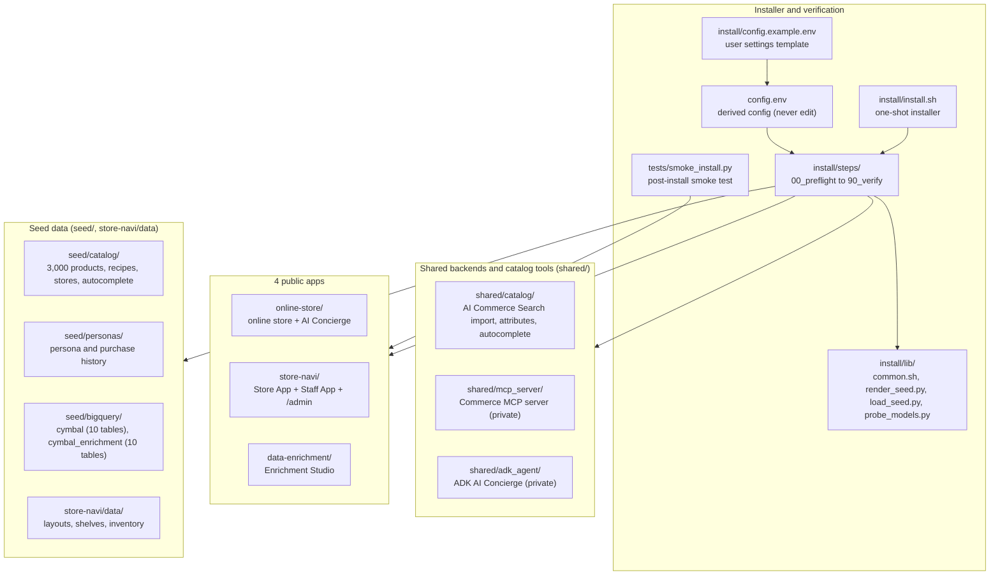

# AGENTS.md: guidelines for AI agents (Jetski, Gemini CLI and other coding agents)

When you open this repository (**Cymbal Retail Agentic Commerce demo, English edition**) with Jetski or another
coding agent, follow these guidelines and the bundled skills. Write all guidance and reports to the user in
**English**.

The Japanese edition of this demo is
[minsoojun-cloud/cymbal-retail-agentic-commerce-demo](https://github.com/minsoojun-cloud/cymbal-retail-agentic-commerce-demo).
It has the same installer design but different apps and data. Do not mix files from the two repositories.

---

## 1. Read the matching skill first

Before you start, load the `SKILL.md` that matches the user's request and follow it step by step.

| The user asks… | Skill to load | What it does |
|---|---|---|
| "Install this demo into my project", "set up the environment" | [`_agents/skills/install-cymbal-demo/SKILL.md`](_agents/skills/install-cymbal-demo/SKILL.md) | Confirm `PROJECT_ID` and `REGION`, then preflight and dry run, run `install/install.sh`, handle public access, verify with `tests/smoke_install.py`, report URLs |
| "Change the brand, logo or colors", "use our products, personas or stores", "change the agent prompt or model" | [`_agents/skills/customize-cymbal-demo/SKILL.md`](_agents/skills/customize-cymbal-demo/SKILL.md) | Edit the right files, then re-run only the affected steps or redeploy only the affected app |

Reference docs: [INSTALL.md](INSTALL.md) (manual runbook), [docs/ARCHITECTURE.md](docs/ARCHITECTURE.md),
[docs/DATA.md](docs/DATA.md), [docs/CUSTOMIZE.md](docs/CUSTOMIZE.md),
[docs/TROUBLESHOOTING.md](docs/TROUBLESHOOTING.md).

---

## 2. Repository map

| Path | Role |
|---|---|
| `install/` | One-shot installer (`install.sh`), uninstaller (`uninstall.sh`), step scripts (`steps/`), helpers (`lib/`). Runtime state goes to `install/.state/` (git-ignored). |
| `install/config.example.env` | Template for `install/config.env`, the only file a user edits to install. |
| `config.env` | **Derived** configuration that every script and `deploy.sh` sources. It computes the project number, buckets, runtime SA and deterministic Cloud Run URLs. Never edit it and never hard-code values in it. |
| `shared/catalog/` | `retail_import.py` (FULL import), `set_attributes_config.py`, `setup_search_features.py` (autocomplete), `validate_jsonl.py`, `category_map_en.json`, BigQuery schema. |
| `shared/mcp_server/` | FastMCP **Commerce MCP server** (`<prefix>-commerce-mcp`, private): `search_products`, `get_product_details`, `compare_products`, `get_customer_profile`, `get_purchase_history`, `recommend_dinner_set`, `check_store_inventory`. |
| `shared/adk_agent/` | **ADK AI Concierge** (`<prefix>-adk-agent`, private). The prompt and tools are in `cymbal_agent/`. |
| `online-store/` | Online store `<prefix>-site`: AI Commerce Search, AI Overview, "Pick up in store" facet, "Available in stores" modal, concierge chat with voice, cart, checkout and order tracking. Product images are in `static/img/products/`. |
| `store-navi/` | One code base, deployed twice: `APP_MODE=customer` gives `<prefix>-store-app` (Store App) and `APP_MODE=staff` gives `<prefix>-store-staff` (Staff App plus the `/admin` Shelf Manager). The in-store agent is in `app/agent/`. `data/` holds store layouts, shelves and inventory. `scripts/push_local_inventory.py` pushes AI Commerce Search Local Inventory. |
| `data-enrichment/` | **Data Enrichment Studio** `<prefix>-data-enrichment`: Gemini extraction, normalization, quality gates, HITL review, GMC attributes, document ingestion, image generation, batch and cost. |
| `seed/` | Project-independent seed. `catalog/` has `products_retail.jsonl` with `__SITE_BASE_URL__` placeholders, plus recipes, stores and autocomplete. `personas/` has the persona and purchase history. `bigquery/<dataset>/<table>.jsonl.gz` comes with a matching `<table>.schema.json`. |
| `tests/smoke_install.py` | End-to-end smoke test after the install. |
| `docs/` | Detailed docs and README images. |

---

## 3. Guardrails (must follow)

> [!CAUTION]
> Follow these rules **without exception**, even when a step fails.

1. **Never bypass organization policies or IAM restrictions.**
   - Never change, disable or override org policies (`gcloud resource-manager org-policies …`, `gcloud org-policies …`),
     and never grant yourself extra roles to get around a denial.
   - Public access is handled only by step `80_public`, using the documented options: an `allUsers` invoker binding,
     or the Cloud Run `--no-invoker-iam-check` setting that the app `deploy.sh` scripts already use. If an app is still
     not public after that (for example because the org enforces `run.managed.requireInvokerIam`), stop. Tell the user
     to ask their org admin or use **Cloud Console > Cloud Run > service > Security > Allow public access**. They can
     also open the app through `gcloud run services proxy` and verify with
     `python3 tests/smoke_install.py --id-token`.
   - Keep the two backends (`<prefix>-commerce-mcp` and `<prefix>-adk-agent`) private. Never make them public.
2. **Confirm the target project.**
   - Never deploy to the current `gcloud config get-value project` unless the user explicitly confirmed it. Always
     confirm `PROJECT_ID` and `REGION` (default `asia-northeast1`). Run `./install/install.sh --dry-run` first and show
     the user the plan.
3. **Never commit secrets or environment-specific files.**
   - Do not commit `install/config.env`, `install/.state/`, `shared/adk_agent/DEPLOYMENT.env`, service-account key
     files, access tokens or real project ids, project numbers and `run.app` URLs.
4. **Keep `seed/` project-independent.**
   - `install/lib/render_seed.py` renders project-specific URLs and ids into `install/.state/rendered/` at install time.
     Never write a specific project's URL, project id or project number into `seed/` or into source code. Use the
     placeholders (`__SITE_BASE_URL__`, `__PROJECT_ID__`, …) or environment variables. The only exception is when you
     deliberately customize the product, persona or store content itself.
   - Never edit the root `config.env` to hard-code values. Users change settings in `install/config.env`.
5. **Don't hard-code Gemini models.**
   - Model availability differs between projects. Use the values that `config.env` resolves (`GEMINI_MODEL`,
     `AGENT_MODEL`, `ENRICH_GEMINI_MODEL`, `IMAGE_MODEL`). These come from `install/config.env`, the demo defaults, or
     the `15_models` probe (`install/.state/models.env`).
6. **Keep the demo English and on-brand.**
   - Everything user-visible stays English. The brand stays **Cymbal Retail**, or the customer's brand when you
     customize it. Never use real retailer or manufacturer names in demo data.
7. **Be careful with destructive commands.**
   - `install/uninstall.sh --data` purges all AI Commerce Search products in branch `0` and deletes the BigQuery datasets. Run it
     only when the user explicitly asks, and never with `-y` unless the user asked for that.

---

## 4. Working conventions

- **Partial re-runs**: prefer `./install/install.sh --steps <step>` or `--from <step>`. To redeploy one app, use
  `source config.env && bash <app>/deploy.sh`. For the store app or staff app, set
  `SERVICE_NAME=$STORE_APP_SERVICE` or `SERVICE_NAME=$STAFF_SERVICE` before `bash store-navi/deploy.sh`.
- **Re-runs are safe**: the installer is idempotent. BigQuery seed tables use `WRITE_TRUNCATE`, runtime tables and
  staff shelf registrations are kept, and the AI Commerce Search FULL import is followed by `push_local_inventory.py --force`.
- **After a catalog change**: run `--from 50_catalog_import`. That step re-imports Retail and re-pushes Local Inventory.
  It also redeploys the apps, which bundle the rendered catalog.
- **Verification is part of done**: finish with `90_verify` (`tests/smoke_install.py`). Report the 4 app URLs plus
  `/admin`, the models in use, and the public-access status as a table.
- **Logs**: app build logs are in `install/.state/logs/<app>.log`. Cloud Run logs are at
  `gcloud run services logs read <service> --project <PROJECT_ID> --region <REGION>`.
