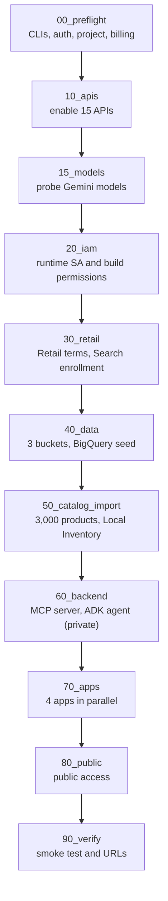

# INSTALL.md: installation runbook (one-shot or step by step)

This runbook shows how to install the Cymbal Retail Agentic Commerce demo (English edition) into your own Google Cloud
project from a terminal, without an AI agent. You can install everything with **one command**, or run the
**11 steps** one at a time.

If you use Jetski, Gemini CLI or another coding agent, open the repository and ask it to *"install this demo into my
project"*. It follows [`AGENTS.md`](AGENTS.md) and the skill
[`_agents/skills/install-cymbal-demo`](_agents/skills/install-cymbal-demo/SKILL.md).

> [!NOTE]
> The original Japanese edition is
> [minsoojun-cloud/cymbal-retail-agentic-commerce-demo](https://github.com/minsoojun-cloud/cymbal-retail-agentic-commerce-demo).
> This repository uses the same installer design, with an English 3,000-product catalog, English UI and data, and
> Retail **Local Inventory** for three stores.

**What gets installed**

| Kind | Resources |
|---|---|
| Cloud Run, private | `<prefix>-commerce-mcp` (Commerce MCP server), `<prefix>-adk-agent` (ADK AI Concierge) |
| Cloud Run, public | `<prefix>-site` (online store), `<prefix>-store-app` (Store App), `<prefix>-store-staff` (Staff App + `/admin` Shelf Manager), `<prefix>-data-enrichment` (Enrichment Studio) |
| Vertex AI Search for Commerce | `default_catalog`, branch `0`: 3,000 products, attribute config, autocomplete, Local Inventory for stores S01 to S03 |
| BigQuery | dataset `cymbal` (products, stores, layouts, shelves, inventory, customers, purchase history, coupons, offers) and `cymbal_enrichment` (Enrichment Studio) |
| Cloud Storage | `<project>-catalog`, `<project>-store-navi`, `products_images_<project>` |
| IAM | runtime service account `<prefix>-runtime@<project>.iam.gserviceaccount.com` |

---

## 1. Prerequisites

### 1.1 Local tools

| Tool | Used for | Check |
|---|---|---|
| Google Cloud SDK (`gcloud`, `bq`) | create resources, load BigQuery, deploy Cloud Run from source | `gcloud --version && bq version` |
| Python 3.9 or later (`python3`) | seed rendering and loading, model probe, Retail import, smoke test (standard library only) | `python3 --version` |
| `curl` | Retail REST calls, health checks | `curl --version` |

Docker is **not** needed: every service is built by Cloud Build (`gcloud run deploy --source`). Git LFS is not needed
either.

### 1.2 Google Cloud project and permissions

1. Use a Google Cloud project with **billing enabled**. A new, dedicated project is recommended.
2. Your user needs **Owner** (`roles/owner`) on the project, or at least these roles:
   - Service Usage Admin (`roles/serviceusage.serviceUsageAdmin`)
   - Service Account Admin (`roles/iam.serviceAccountAdmin`) and Project IAM Admin (`roles/resourcemanager.projectIamAdmin`)
   - Cloud Run Admin (`roles/run.admin`) and Cloud Build Editor (`roles/cloudbuild.builds.editor`)
   - BigQuery Admin (`roles/bigquery.admin`) and Storage Admin (`roles/storage.admin`)
   - Retail Admin (`roles/retail.admin`) and Vertex AI User (`roles/aiplatform.user`)
3. Sign in:
   ```bash
   gcloud auth login
   ```

---

## 2. Create `install/config.env`

```bash
cp install/config.example.env install/config.env
```

Open `install/config.env` and set at least `PROJECT_ID`:

```bash
PROJECT_ID="your-project-id"   # required, billing enabled
REGION="asia-northeast1"       # Cloud Run, BigQuery and Cloud Storage region (default)
SERVICE_PREFIX="cymbal"        # Cloud Run service-name prefix (default)
VOICE_ENABLED="1"              # voice input and read-aloud in the online-store concierge
```

| Setting | Default | Notes |
|---|---|---|
| `PROJECT_ID` | (required) | Can also be passed as `--project`. |
| `REGION` | `asia-northeast1` | Can also be passed as `--region`. |
| `SERVICE_PREFIX` | `cymbal` | Lowercase, at most 21 characters. Use a different prefix to install a second copy in the same project. |
| `RUNTIME_SA_NAME` | `${SERVICE_PREFIX}-runtime` | |
| `BQ_DATASET`, `ENRICH_BQ_DATASET` | `cymbal`, `cymbal_enrichment` | |
| `CATALOG_BUCKET`, `STORE_NAVI_BUCKET`, `ENRICH_IMAGE_BUCKET` | derived from `PROJECT_ID` | |
| `GEMINI_MODEL` | `gemini-3-flash-preview` | Search query understanding, store app helpers. |
| `AGENT_MODEL` | `gemini-3.5-flash` | ADK AI Concierge and the store app's "Ask AI". |
| `ENRICH_GEMINI_MODEL` | `gemini-3.8-flash` | Enrichment Studio attribute extraction. |
| `IMAGE_MODEL` | `gemini-3.1-flash-image` | Enrichment Studio image generation. |
| `GEMINI_LOCATION` | `global` | Vertex AI location for Gemini. |

> [!IMPORTANT]
> - `install/config.env` is git-ignored. Never put credentials or keys in it.
> - Do **not** edit the root [`config.env`](config.env). It is the *derived* configuration that every script and
>   `deploy.sh` sources. It computes the project number, bucket names, the service-account e-mail and the
>   deterministic Cloud Run URLs (`https://<service>-<project-number>.<region>.run.app`) from `install/config.env`.
>   Environment variables that are already exported always take precedence.
> - Leave the model fields empty to use the defaults. Step `15_models` checks that each model answers in your project
>   and records a working fallback in `install/.state/models.env` if it does not.

---

## 3. One-shot install (recommended)

```bash
./install/install.sh
```

The installer shows the resolved configuration and asks for confirmation (`-y` skips the prompt). It then runs all 11
steps in order. A first install takes about **35 to 50 minutes**. Most of that time is the Retail catalog import, the
Local Inventory push for three stores, and six Cloud Build builds.

### Options

| Option | Meaning |
|---|---|
| `--project <PROJECT_ID>` | Target project (overrides `install/config.env`). |
| `--region <REGION>` | Region (default `asia-northeast1`). |
| `--prefix <PREFIX>` | Cloud Run service-name prefix (default `cymbal`). |
| `--config <FILE>` | Use another config file instead of `install/config.env`. |
| `--steps <s1,s2,...>` | Run only these steps. |
| `--from <STEP>` | Run from this step to the end. |
| `--resume` | Skip steps that are already done (`install/.state/<step>.done`). |
| `--sequential` | Deploy the 4 apps one after another instead of in parallel. |
| `--dry-run` | Resolve the configuration and print the plan and commands, without changing anything. |
| `-y`, `--yes` | Do not ask for confirmation. |

```bash
# Preview the plan and the computed URLs without changing anything
./install/install.sh --dry-run

# Pass the project and region on the command line
./install/install.sh --project your-project-id --region asia-northeast1 -y

# After an interruption: skip completed steps
./install/install.sh --resume

# From one step to the end (e.g. after editing the catalog)
./install/install.sh --from 50_catalog_import

# Only some steps (e.g. redeploy the apps and verify)
./install/install.sh --steps 70_apps,90_verify

# Build the 4 apps one at a time (lower Cloud Build concurrency)
./install/install.sh --sequential
```

If a step fails, the installer stops and prints the exact command to continue, for example
`./install/install.sh --from 50_catalog_import`.

> [!TIP]
> **Every step is idempotent.** You can re-run the installer at any time:
> - BigQuery seed tables are loaded with `WRITE_TRUNCATE` (`bq load --replace`).
> - Tables whose seed is empty (runtime logs such as `store_inventory_events`, `review_log` and `token_usage`) are only
>   created when they are missing, so runtime data is kept.
> - Shelf registrations made in the Staff App (`cymbal.shelf_locations` rows with `source='staff'`) are preserved when
>   their slots still exist.
> - The Retail catalog is re-imported with `FULL` reconciliation, and Local Inventory is re-pushed with
>   `push_local_inventory.py --force`.
> - Existing service accounts, buckets, datasets and IAM bindings are reused.

---

## 4. Step-by-step reference (11 steps)

To watch each phase, run `./install/install.sh --steps <step>` (or `bash install/steps/<step>.sh`) from top to bottom.



### Step 1: `00_preflight`: preflight checks

```bash
./install/install.sh --steps 00_preflight
```

- Checks that `gcloud`, `bq`, `python3` (3.9 or later) and `curl` are installed, that an active `gcloud` account can mint
  an access token, that the project is `ACTIVE` and billing is enabled, and that `SERVICE_PREFIX` is valid.
- Checks that the seed files exist (`seed/catalog/products_retail.jsonl`, `seed/bigquery/cymbal/stores.jsonl.gz`,
  `online-store/static/img/products/`).
- Prints the configuration summary: project, region, prefix, runtime SA, datasets, buckets, models and the 4 app URLs.
  **Check that `PROJECT_ID` and `REGION` are what you expect.**

### Step 2: `10_apis`: enable Google Cloud APIs

```bash
./install/install.sh --steps 10_apis
```

Enables `run`, `cloudbuild`, `artifactregistry`, `retail`, `aiplatform`, `bigquery`, `storage`, `iam`,
`iamcredentials`, `speech`, `texttospeech`, `logging`, `monitoring`, `cloudresourcemanager` and `serviceusage`
(`*.googleapis.com`). This takes 1 to 2 minutes on a new project.

### Step 3: `15_models`: verify Gemini models

```bash
./install/install.sh --steps 15_models
cat install/.state/models.env   # only written when a fallback was needed
```

`install/lib/probe_models.py` sends a tiny `generateContent` request to Vertex AI (`global`) for each role. If the
configured model or the default model does not answer, it tries the fallbacks in order. The first fallback that works is
written to `install/.state/models.env` as `PROBED_<ROLE>=...`. `config.env` uses that value only when you did not pin
a model yourself.

| Role | Default | Fallbacks, in order |
|---|---|---|
| `GEMINI_MODEL` | `gemini-3-flash-preview` | `gemini-3.5-flash`, `gemini-3.8-flash`, `gemini-2.5-flash` |
| `AGENT_MODEL` | `gemini-3.5-flash` | `gemini-3.8-flash`, `gemini-3-flash-preview`, `gemini-2.5-flash` |
| `ENRICH_GEMINI_MODEL` | `gemini-3.8-flash` | `gemini-3.5-flash`, `gemini-3-flash-preview`, `gemini-2.5-flash` |
| `GEMINI_FALLBACK_MODEL` | `gemini-3.5-flash` | `gemini-3-flash-preview`, `gemini-2.5-flash` |
| `IMAGE_MODEL` | `gemini-3.1-flash-image` | `gemini-3-pro-image`, `gemini-2.5-flash-image` |

### Step 4: `20_iam`: runtime service account and build permissions

```bash
./install/install.sh --steps 20_iam
```

- Creates `${SERVICE_PREFIX}-runtime@${PROJECT_ID}.iam.gserviceaccount.com`. All 6 Cloud Run services run as this
  account.
- Grants it `retail.editor`, `bigquery.dataEditor`, `bigquery.jobUser`, `storage.objectAdmin`, `aiplatform.user`,
  `run.invoker` (to call the private backends), `logging.logWriter`, `monitoring.metricWriter`, `cloudtrace.agent`,
  `iam.serviceAccountTokenCreator` and `serviceusage.serviceUsageConsumer`.
- For source deploys: grants the default compute SA `run.builder`, `storage.objectAdmin`, `artifactregistry.writer` and
  `logging.logWriter`. Grants the Cloud Build SA `cloudbuild.builds.builder`, `run.admin` and `iam.serviceAccountUser`.
  Lets both act as the runtime SA, and creates the Artifact Registry repository `cloud-run-source-deploy`.

### Step 5: `30_retail`: Vertex AI Search for Commerce

```bash
./install/install.sh --steps 30_retail
```

Accepts the Retail data-use terms (`retailProject:acceptTerms`), enrolls `SOLUTION_TYPE_SEARCH`, creates the Retail
service agent, and grants it BigQuery `dataViewer` and `jobUser` (it needs them for the autocomplete import). If
`acceptTerms` fails, accept the terms once in the Cloud Console (**Search for commerce > Get started**), then re-run the
step.

### Step 6: `40_data`: buckets and BigQuery seed

```bash
./install/install.sh --steps 40_data
bq ls "${PROJECT_ID}:cymbal"; bq ls "${PROJECT_ID}:cymbal_enrichment"
```

1. Creates the three buckets with uniform bucket-level access: `${PROJECT_ID}-catalog`, `${PROJECT_ID}-store-navi`
   and `products_images_${PROJECT_ID}`. Grants the Retail service agent read access on the catalog bucket.
2. `install/lib/render_seed.py` renders the project-independent seed for your project into
   `install/.state/rendered/`. Placeholders such as `__SITE_BASE_URL__`, `__STORE_APP_URL__`, `__PROJECT_ID__` and
   `__PROJECT_NUMBER__` are replaced with your values. Files under `seed/` are never modified.
3. `install/lib/load_seed.py` creates the datasets and loads the 10 `cymbal` seed tables (stores, layouts, shelf
   slots and locations, inventory, inventory events, coupons, offers, customers, purchase history) and the 10
   `cymbal_enrichment` tables (63-SKU Enrichment Studio seed). Each table uses its exported `*.schema.json`. See
   [docs/DATA.md](docs/DATA.md).

### Step 7: `50_catalog_import`: catalog, Retail import, Local Inventory

```bash
./install/install.sh --steps 50_catalog_import
```

1. Uploads the rendered catalog (3,000 products, `languageCode: en`, JPY) to `gs://${PROJECT_ID}-catalog/catalog/`.
2. Loads BigQuery `cymbal.products` (Retail schema plus a top-level `channel` column: `omni`, `store_only` or
   `online_only`).
3. Runs the Retail `products:import` with **FULL** reconciliation from GCS (2 to 5 minutes).
4. Applies the attribute config (facets, filterable and retrievable attributes) with
   `shared/catalog/set_attributes_config.py`.
5. Imports autocomplete suggestions from `cymbal.autocomplete_suggestions`. If this fails, you only get a warning, and
   you can re-run `python3 shared/catalog/setup_search_features.py --autocomplete-only` later.
6. Pushes **Local Inventory** for stores S01 to S03 with `store-navi/scripts/push_local_inventory.py --force` (5 to 8
   minutes). For each store it pushes `placeId` = store id, `quantity`, `availability`, `shelf_id`, `slot_ids` and
   `tier`, plus `pickup-in-store` when the item is in stock.

### Step 8: `60_backend`: private backends

```bash
./install/install.sh --steps 60_backend
```

1. `shared/mcp_server/deploy.sh` deploys `<prefix>-commerce-mcp`, the FastMCP server with the tools
   `search_products`, `get_product_details`, `compare_products`, `get_customer_profile`, `get_purchase_history`,
   `recommend_dinner_set` and `check_store_inventory`. It requires authentication and runs with min 1 instance.
2. `shared/adk_agent/deploy.sh` deploys `<prefix>-adk-agent`, the ADK AI Concierge (model `AGENT_MODEL`, min 1 and
   max 1 instance, connected to the MCP server). It also requires authentication. The runtime SA calls it with
   `run.invoker`.

### Step 9: `70_apps`: the 4 apps

```bash
./install/install.sh --steps 70_apps
tail -f install/.state/logs/site.log   # one log per app
```

Deploys the 4 public apps **in parallel** (or one by one with `--sequential`). Each build log goes to
`install/.state/logs/<app>.log`.

| Label | Command | Service |
|---|---|---|
| `site` | `bash online-store/deploy.sh` | `<prefix>-site` |
| `store-app` | `SERVICE_NAME=$STORE_APP_SERVICE bash store-navi/deploy.sh` | `<prefix>-store-app` (`APP_MODE=customer`) |
| `store-staff` | `SERVICE_NAME=$STAFF_SERVICE bash store-navi/deploy.sh` | `<prefix>-store-staff` (`APP_MODE=staff`, includes `/admin`) |
| `data-enrichment` | `bash data-enrichment/deploy.sh` | `<prefix>-data-enrichment` |

The cross links between the apps (header icons, "Buy online", "Open Store App") use the deterministic URLs from
`config.env`. You don't need a second deploy to wire them up.

### Step 10: `80_public`: public access

```bash
./install/install.sh --steps 80_public
```

The apps are meant to be opened in a browser without signing in. For each of the 4 apps, the step does the following:

1. If `/api/health` already answers HTTP 200 anonymously, there is nothing to do.
2. Otherwise it grants `roles/run.invoker` to `allUsers`.
3. If the organization rejects `allUsers` bindings (the Domain Restricted Sharing policy
   `iam.allowedPolicyMemberDomains`), it switches the service to `--no-invoker-iam-check`. This is the Cloud Run
   setting for serving public traffic without an `allUsers` binding. The app `deploy.sh` scripts also deploy with this
   flag.

The two backends (MCP server and ADK agent) always stay private.

If an app is still not reachable, for example because the org enforces `run.managed.requireInvokerIam`, the step stops
and lists the supported options. Ask your org admin, or use **Cloud Console > Cloud Run > service > Security > Allow
public access**, or open the app through an authenticated local proxy:

```bash
gcloud run services proxy <prefix>-site --project <PROJECT_ID> --region <REGION> --port 8080
```

Never change organization policies yourself to work around this.

### Step 11: `90_verify`: smoke test and URL summary

```bash
./install/install.sh --steps 90_verify
# or on its own:
source config.env && python3 tests/smoke_install.py
# when the apps are not public:
source config.env && python3 tests/smoke_install.py --id-token
```

`tests/smoke_install.py` checks the following:

- All 4 apps return HTTP 200 on `/` and `/api/health`.
- Online store: searching `curry` returns products, and `/api/products/<id>/stores` answers from
  `retail_local_inventory`.
- Store app: 3,000 products are on the Retail engine, and availability at S01 comes from Retail Local Inventory.
- Staff app: the staff router is enabled and the manager console `/admin` is reachable.
- Enrichment Studio: the 63 seeded SKUs are present.

At the end, the step prints the URLs:

```text
Online store (PC / mobile) : https://<prefix>-site-<project-number>.<region>.run.app
Store app (phone / tablet) : https://<prefix>-store-app-...
Staff app (mobile)         : https://<prefix>-store-staff-...
Manager console (PC)       : https://<prefix>-store-staff-.../admin
Enrichment Studio          : https://<prefix>-data-enrichment-...
```

---

## 5. After the install

- **Redeploy one app** after a code change. You don't need to run the whole installer:
  ```bash
  source config.env && bash online-store/deploy.sh
  source config.env && SERVICE_NAME=$STORE_APP_SERVICE bash store-navi/deploy.sh
  source config.env && SERVICE_NAME=$STAFF_SERVICE bash store-navi/deploy.sh
  source config.env && bash data-enrichment/deploy.sh
  source config.env && bash shared/adk_agent/deploy.sh      # or shared/mcp_server/deploy.sh
  ```
- **Customize** the brand, catalog, personas, stores or agent prompts: see [docs/CUSTOMIZE.md](docs/CUSTOMIZE.md).
- **Problems**: see [docs/TROUBLESHOOTING.md](docs/TROUBLESHOOTING.md).
- **How it fits together**: see [docs/ARCHITECTURE.md](docs/ARCHITECTURE.md) and [docs/DATA.md](docs/DATA.md).

---

## 6. Uninstall

```bash
# Delete only the 6 Cloud Run services (BigQuery, buckets and the service account are kept)
./install/uninstall.sh

# Also delete the BigQuery datasets and the Retail products (branch 0), the 3 buckets and the runtime SA
./install/uninstall.sh --all
```

| Flag | Also deletes |
|---|---|
| `--data` | BigQuery datasets `cymbal` and `cymbal_enrichment`, and all Retail products in `default_catalog` branch `0` (purge) |
| `--buckets` | The 3 Cloud Storage buckets |
| `--sa` | The runtime service account |
| `--all` | All of the above |

To prevent accidents, the script asks you to type the project id (`-y` skips this). It accepts `--project`, `--region`,
`--prefix` and `--config` like `install.sh`. APIs, the Retail enrollment and organization settings are never changed.
