# Cymbal Retail — Agentic Commerce Demo (English edition)

> 日本語版 (Japanese version): https://github.com/minsoojun-cloud/cymbal-retail-agentic-commerce-demo

An installable, end-to-end **agentic commerce** demo for a fictional grocery & drugstore chain, **Cymbal Retail**.
One shopper journey — from the online store on a PC, to the store app on a phone or tablet in the aisle, to the staff
member who registers a shelf with a photo — all running on **one shared data spine**: **AI Commerce Search**
(catalog + per-store **Local Inventory**), **BigQuery**, **Gemini on Vertex AI**, an **ADK** agent and a **Commerce MCP server**.

One command installs everything (6 Cloud Run services, a 3,000-product English catalog, 3 stores with floor plans and
shelf maps, personas, purchase history and the Enrichment Studio seed) into **your** Google Cloud project.

[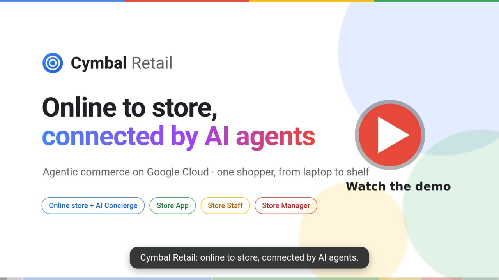](https://github.com/minsoojun-cloud/cymbal-retail-agentic-commerce-en-demo/releases/download/v1.0.1/cymbal_agentic_commerce_demo_en.mp4)

**▶ [Demo video (4:26)](https://github.com/minsoojun-cloud/cymbal-retail-agentic-commerce-en-demo/releases/download/v1.0.1/cymbal_agentic_commerce_demo_en.mp4)**
· [English subtitles (.vtt)](https://github.com/minsoojun-cloud/cymbal-retail-agentic-commerce-en-demo/releases/download/v1.0.1/cymbal_agentic_commerce_demo_en.vtt)
· [Release v1.0.1](https://github.com/minsoojun-cloud/cymbal-retail-agentic-commerce-en-demo/releases/tag/v1.0.1)

---

## Contents

- [What you get](#what-you-get)
- [Architecture](#architecture)
- [The apps](#the-apps) — online store, store app (phone + tablet), staff app, manager console, Enrichment Studio
- [Data spine](#data-spine)
- [Quick start](#quick-start) — with Jetski, or manually
- [Customization](#customization)
- [Troubleshooting](#troubleshooting)
- [Repository layout](#repository-layout)

---

## What you get

| # | Cloud Run service (`SERVICE_PREFIX=cymbal`) | Source | Access | What it is |
|---|---|---|---|---|
| 1 | `cymbal-site` | [`online-store/`](online-store/) | public | PC / mobile online store with search, "Pick up in store", **Available in stores** and the **AI Concierge** (chat + voice) |
| 2 | `cymbal-store-app` | [`store-navi/`](store-navi/) (`APP_MODE=customer`) | public | In-store app for phone and tablet: live stock & shelf, floor-map route, recipes, "Forgot something?", **Ask AI** |
| 3 | `cymbal-store-staff` | [`store-navi/`](store-navi/) (`APP_MODE=staff`) | public | Staff app (shelf-photo registration → Local Inventory sync) and the **manager console** at `/admin` |
| 4 | `cymbal-data-enrichment` | [`data-enrichment/`](data-enrichment/) | public | Product Data Enrichment Studio (Gemini extraction, rules, HITL review, golden records) |
| 5 | `cymbal-adk-agent` | [`shared/adk_agent/`](shared/adk_agent/) | private | ADK AI Concierge agent (Gemini) used by the online store |
| 6 | `cymbal-commerce-mcp` | [`shared/mcp_server/`](shared/mcp_server/) | private | Commerce MCP server: search, customer profile, cart/orders, dinner sets, **store inventory** |

Everything user-visible is English; prices are JPY (tax included) and the stores are in the Tokyo area
(S01 Kawasaki Station, S02 Musashi-Kosugi, S03 Shibuya). The persona is **Sakura Tanaka** (`CR-0001`, family of four,
the kids are allergic to shrimp).

---

## Architecture

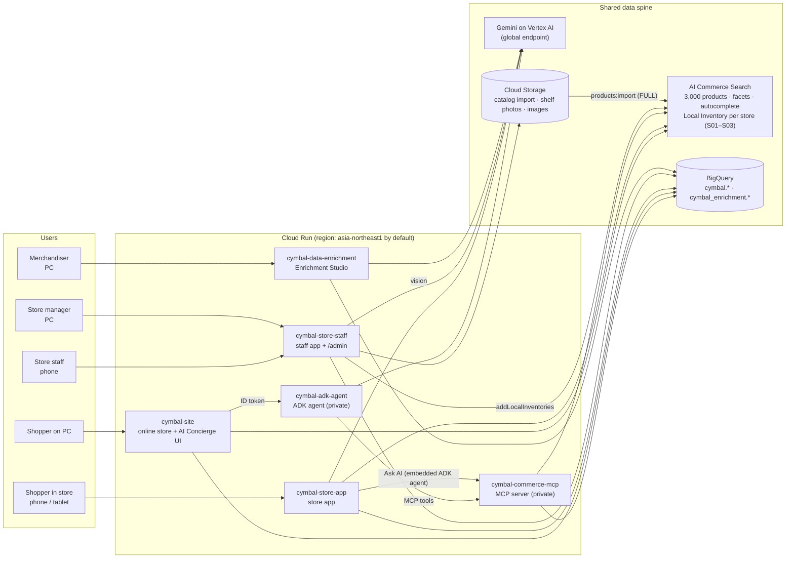

- The **online store** proxies chat to the private **ADK agent** with its service-account ID token; the agent reaches
  commerce data only through **MCP tools** (`search_products`, `get_customer_profile`, `build_dinner_set`,
  `check_store_inventory`, cart/checkout tools …) and drives the page with UI actions (add to cart, open the
  *Available in stores* modal, checkout steps).
- The **store app** embeds the same ADK agent pattern for *Ask AI*, calls the same MCP server, and reads live stock from
  Retail **Local Inventory** (`placeId` = store id; `quantity`, `availability`, `shelf_id`, `slot_ids`, `tier`,
  `pickup-in-store`).
- The **staff app** writes shelf registrations to BigQuery and pushes them to Local Inventory in real time, so the
  online store and the store app show the new shelf within seconds.
- **No project id, project number or URL is hard-coded**: Cloud Run URLs are derived at install time from your
  project number (`https://<service>-<project-number>.<region>.run.app`) and the catalog's product/image URLs are
  rewritten for your project when the seed is loaded.

More detail: [docs/ARCHITECTURE.md](docs/ARCHITECTURE.md).

---

## The apps

The demo follows one shopper, **Sakura Tanaka** (customer `CR-0001`, a family of four whose kids are allergic to shrimp),
from her laptop to the store shelf. Then it shows how store staff, store managers and merchandisers keep the shared data
accurate. All five apps run on Cloud Run and share one data spine: **AI Commerce Search** (catalog plus
**Local Inventory** for each store), **BigQuery**, **Gemini**, an **ADK** agent and a **Commerce MCP server**.


| # | App (Cloud Run service) | Who uses it | Device |
|---|---|---|---|
| 1 | Online Store + AI Concierge (`cymbal-site`) | Shopper | PC |
| 2 | Store App (`cymbal-store-app`) | Shopper, in the store | Phone and tablet |
| 3 | Store Staff App (`cymbal-store-staff`) | Store staff | Tablet, phone or PC |
| 4 | Shelf Manager (`cymbal-store-staff`, `/admin`) | Store manager | PC |
| 5 | Data Enrichment Studio (`cymbal-data-enrichment`) | Merchandiser | PC |

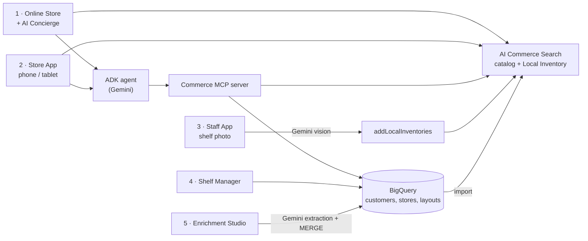

---

### 1. Online Store + AI Concierge (`cymbal-site`, PC)

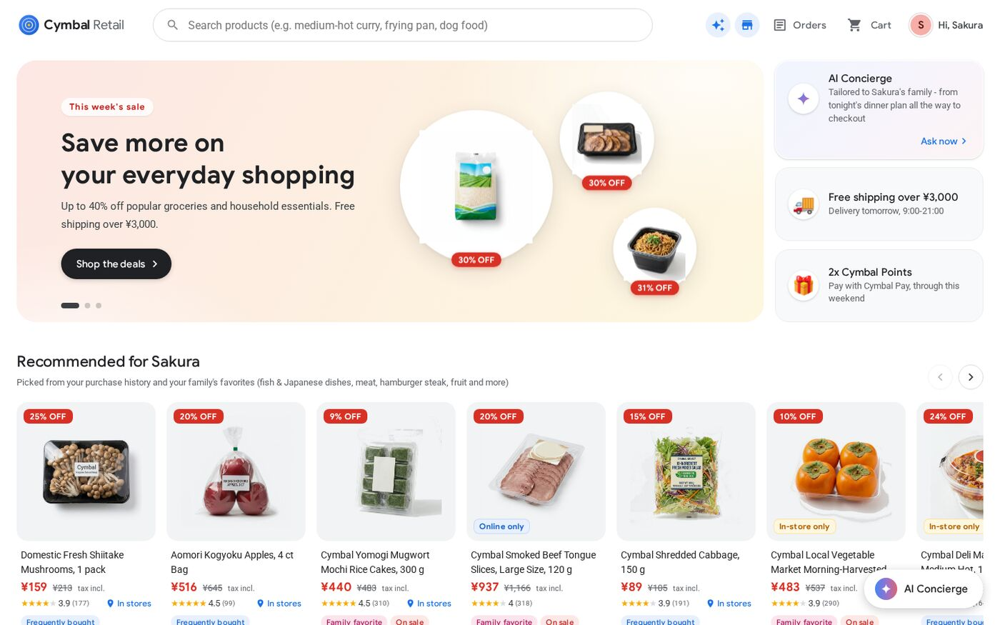

**Home.** The storefront is signed in as Sakura. *Recommended for Sakura* is personalized from her purchase history and
household profile. Each product card shows its sales channel: **Online only**, **In-store only**, or **In stores** (sold
online and in stores). The AI Concierge entry card is at the top right. The header has round icon links to the Store App
and the other demo apps.

| Search with the "Pick up in store" facet | Store-only product |
|---|---|
| 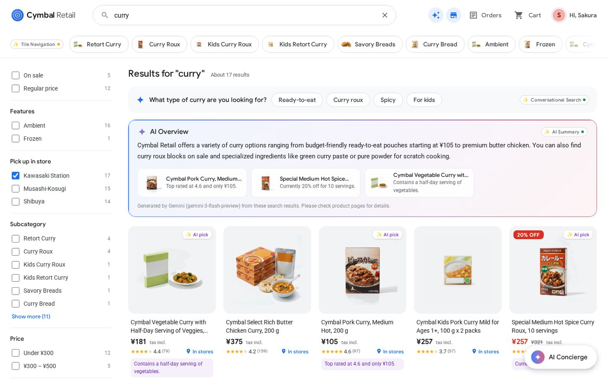 | 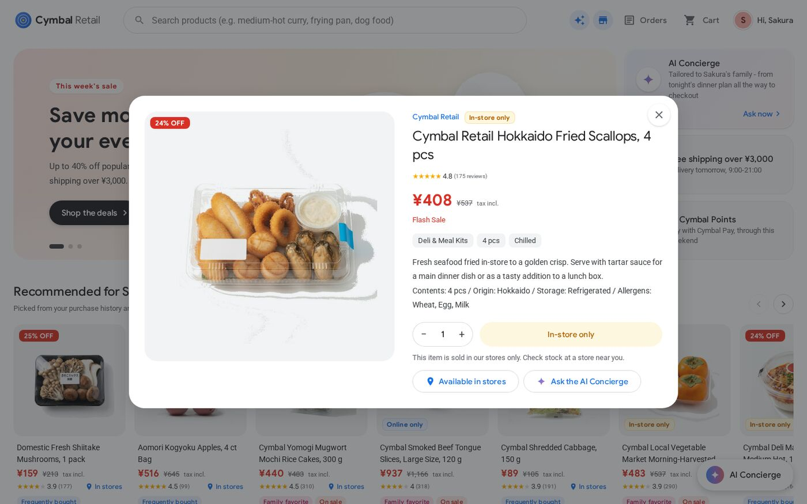 |

**Search.** Results come from **AI Commerce Search**: dynamic facets (category, brand, deals, features), an
**AI Overview** that Gemini writes from the search results, and conversational refinement chips such as *"What type of
curry are you looking for?"*. The **Pick up in store** facet (Kawasaki Station, Musashi-Kosugi, Shibuya) filters on
**Local Inventory** with `pickupInStore: ANY("S01")`. The shopper sees only what her nearby store has on the shelf.

**Store-only items.** Deli, sushi, in-store bakery, flowers and pharmacist-only medicines are labelled **In-store only**.
Most sites would stop at this point. Here, the shopper can open **Available in stores** or **Ask the AI Concierge**.

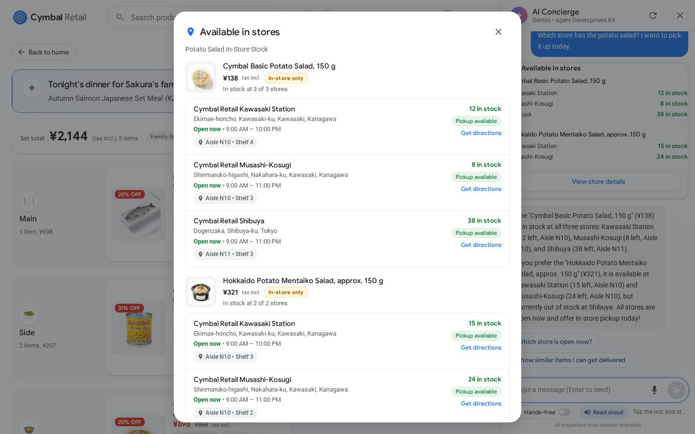

**"Available in stores" (Local Inventory).** Sakura asks the concierge *"Which store has the potato salad?"*. The agent
calls the MCP tool `check_store_inventory` (agent tool `find_store_stock`) and opens the **Available in stores** modal
with the page action `show_store_availability`. For each store, the modal shows the address, **Open now** and opening
hours, the **quantity in stock**, **Pickup available**, and the **aisle and shelf label**. Quantity, availability and
`shelf_id` are read from each store's Retail **LocalInventory** (`placeId` = store id). Store addresses and hours are
joined from the BigQuery store master. If the LocalInventory call fails, the API falls back to the BigQuery
`store_inventory` table.

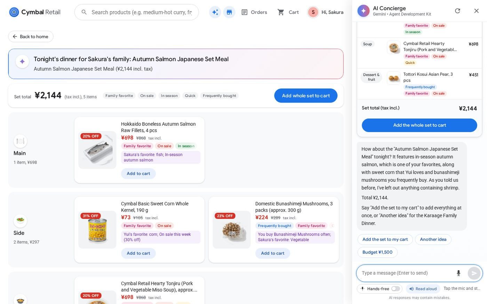

**AI Concierge: dinner set with the shrimp-allergy guard.** Sakura asks for *"tonight's dinner for 4, no shrimp"*. The
concierge is an **ADK (Agent Development Kit) agent on Gemini**, and it reaches commerce data only through **MCP tools**
(AI Commerce Search, customer profile and purchase history, cart, orders, store stock). The agent builds a complete
**Autumn Salmon Japanese Set Meal**: main, side, soup and dessert, with a set total. Every item comes from Vertex AI
AI Commerce Search. Tags such as *Family favorite*, *Frequently bought*, *On sale* and *In season* explain why each item
was picked. The agent **leaves out every item that contains shrimp** because the household profile in BigQuery lists the
kids' allergy, and its reply says so. One click on **Add the whole set to cart** fills the cart. Voice input and
read-aloud are also available.

| Checkout in the chat (delivery slot) | Order placed |
|---|---|
| 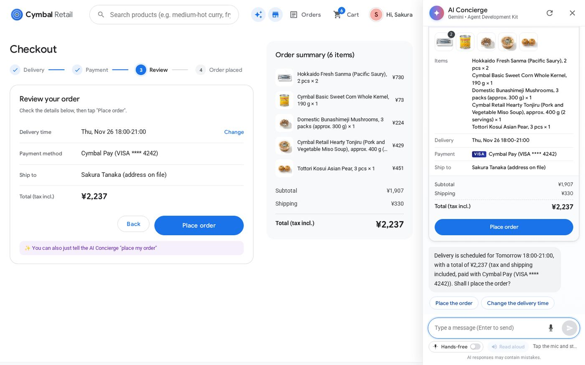 | 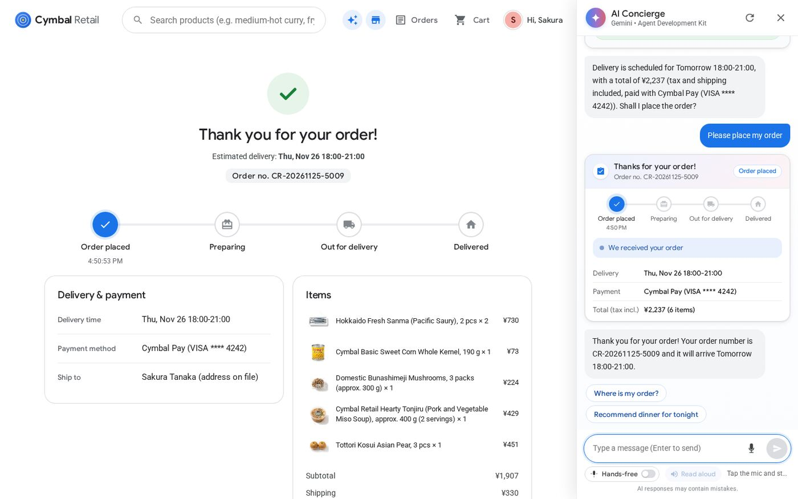 |

**Checkout and order.** Sakura can check out without leaving the chat. The agent proposes delivery slots as buttons
(*"Tomorrow afternoon please"*), shows the review step (delivery time, Cymbal Pay, ship-to), and places the order on
*"Please place my order"*. The page and the chat stay in sync: the checkout steps, the confirmation, and an order tracker
(*Order placed → Preparing → Out for delivery → Delivered*).

---

### 2. Store App (`cymbal-store-app`, phone and tablet)

The same catalog, the same Local Inventory and the same agent, now inside the store. The app is a single responsive web
app. On a phone it uses a bottom tab bar. On an in-store tablet it shows the list, floor map and AI Concierge side by
side.

| Store home | Search + live stock | Find on map | Forgot something? |
|:---:|:---:|:---:|:---:|
| 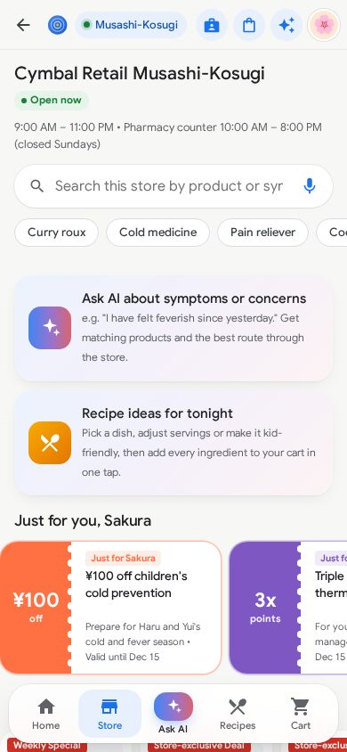 | 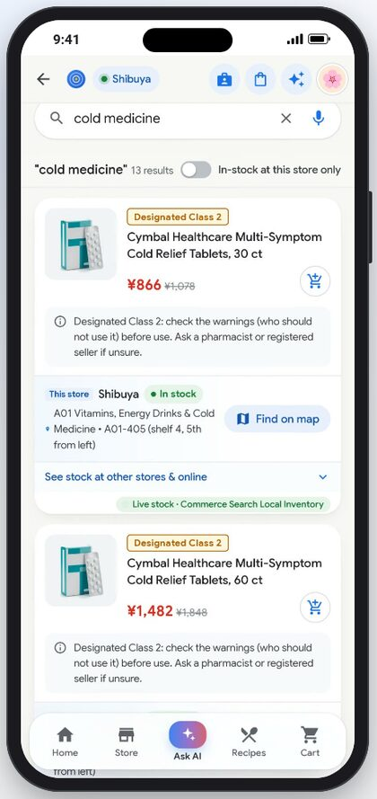 | 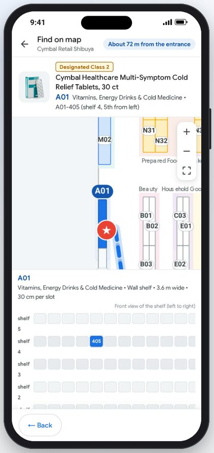 | 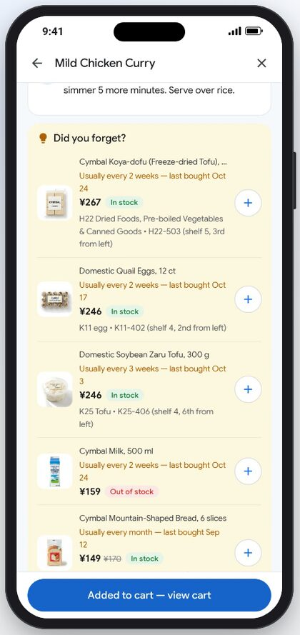 |

- **Store home**: the selected store (*Open now*, hours, pharmacy counter hours), store search by product **or
  symptom**, quick chips, *Ask AI about symptoms or concerns*, *Recipe ideas for tonight*, and coupons *Just for you,
  Sakura*.
- **Search + live stock**: every result shows **This store · In stock** and the exact **shelf and slot** (e.g. `A01-405`,
  shelf 4, 5th from left). The **"Live stock · AI Commerce Search Local Inventory"** badge shows where the data comes from.
  OTC medicines show their drug class (e.g. *Designated Class 2*) with the safety notes the law requires. *See stock at
  other stores & online* lists the other stores, and **Buy online** opens the product in the Online Store.
- **Find on map**: the store floor map (store layouts in BigQuery) draws the walking route from the entrance (*About 72 m
  from the entrance*). It highlights the shelf, then shows a **front view of the shelf** with the exact slot.
- **Recipes and "Forgot something?"**: the recipe concierge adds every ingredient of a dish to the cart in one tap
  (servings, kid-friendly and quick options). It then asks **"Did you forget?"** and lists items Sakura usually buys
  (*Usually every 2 weeks, last bought Oct 24*), based on her purchase history in BigQuery. Each item shows its stock and
  shelf in this store.

| Recipe ideas | Ask AI (safe health answers) | "How I answered" |
|:---:|:---:|:---:|
| 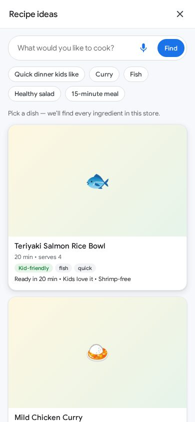 | 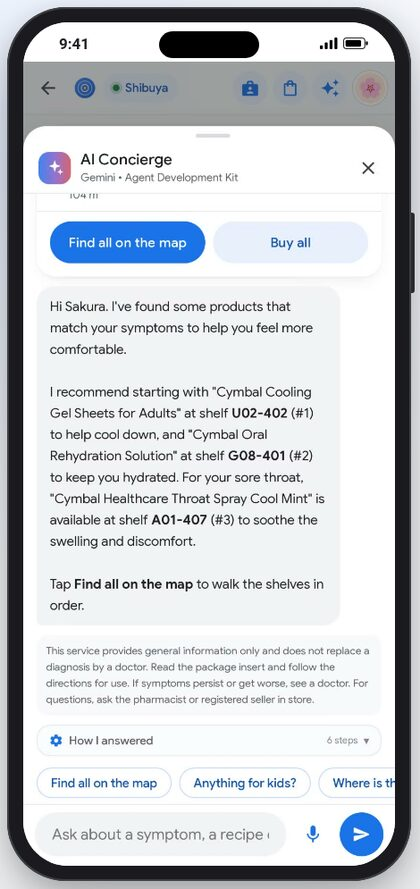 | 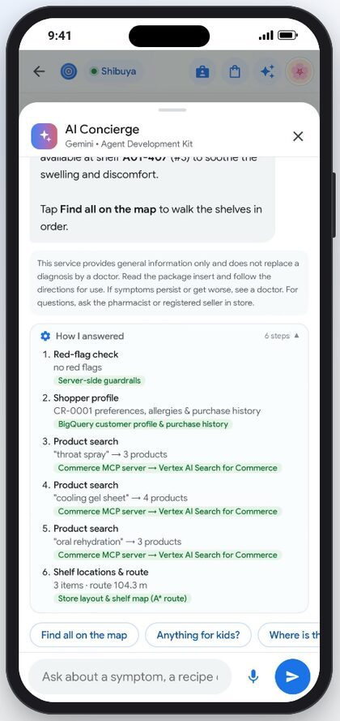 |

- **Ask AI**: *"I've had a fever since yesterday…"*. The AI Concierge (the **ADK agent on Gemini** + **Commerce MCP
  server**) suggests OTC products that are **in stock in this store**, with their shelf numbers, and offers **Find all on
  the map** (a multi-stop route) and **Buy all**. It follows a health-safety policy: it never diagnoses, adds a
  disclaimer, and refers the shopper to the pharmacist for pharmacist-only (Class 1) medicines.
- **"How I answered"**: each answer can be expanded to show the steps and data sources the agent used:
  *Red-flag check* (server-side guardrails) → *Shopper profile* (BigQuery customer profile and purchase history) →
  *Product search* (Commerce MCP server → AI Commerce Search) → *Shelf locations and route* (store layout and
  shelf map, A* route). Every answer can be traced.

**Tablet layouts** (landscape 1180×820 and portrait 820×1180):

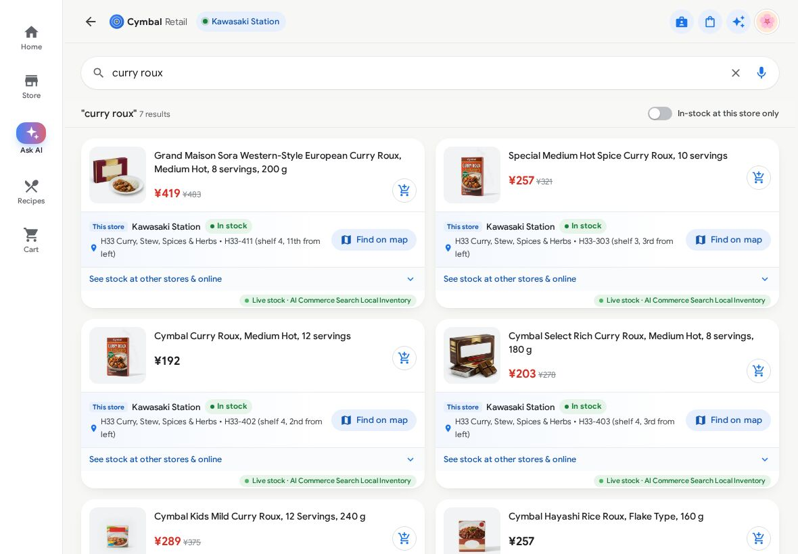

| Tablet store home | Tablet recipe concierge | Tablet portrait floor map |
|:---:|:---:|:---:|
| 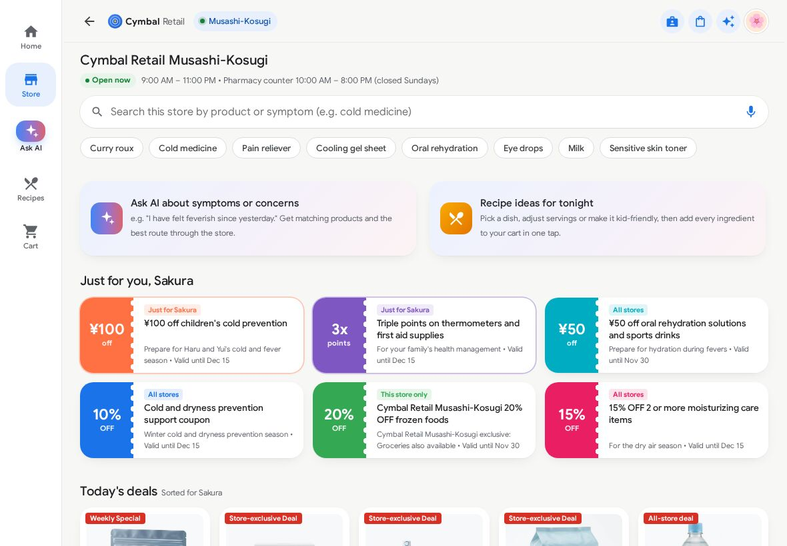 | 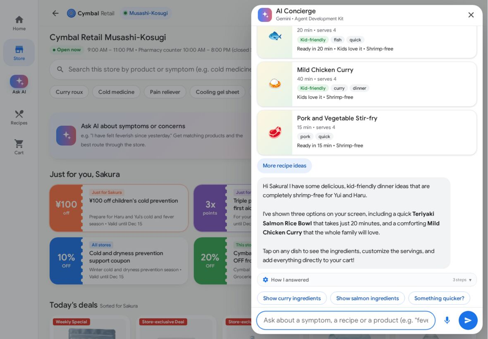 | 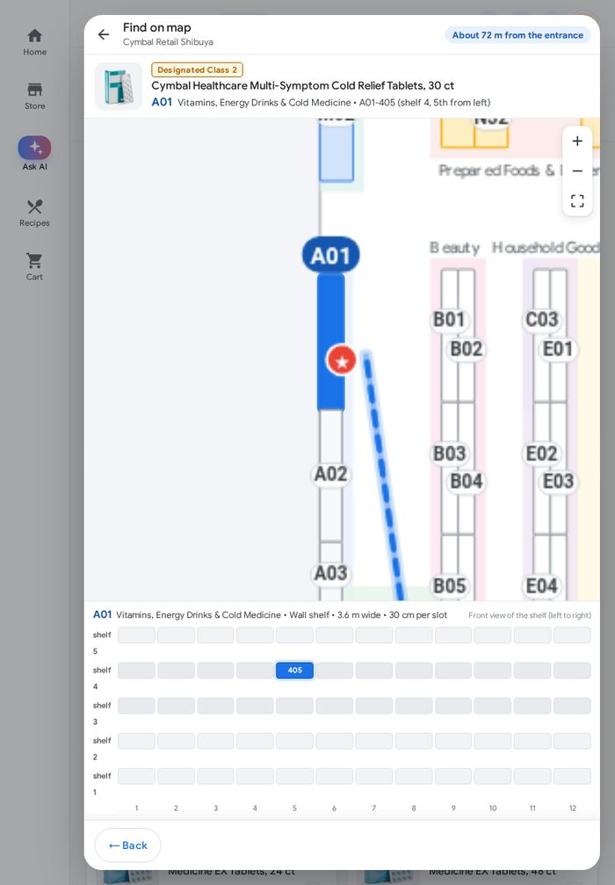 |

On a tablet the layout adapts dynamically: results flow into two columns with live stock and the exact shelf for each
item, and the product detail, the **floor map with the shelf front view** and the **AI Concierge** open as large sheets
over the list (in the recipe concierge, the chat docks beside the store home). Kiosks and staff-assisted selling can use
the same app with no separate build.

---

### 3. Store Staff App (`cymbal-store-staff`): shelf photo registration

| 1. Take or pick a shelf photo | 2. Gemini reads the shelf and product |
|---|---|
| 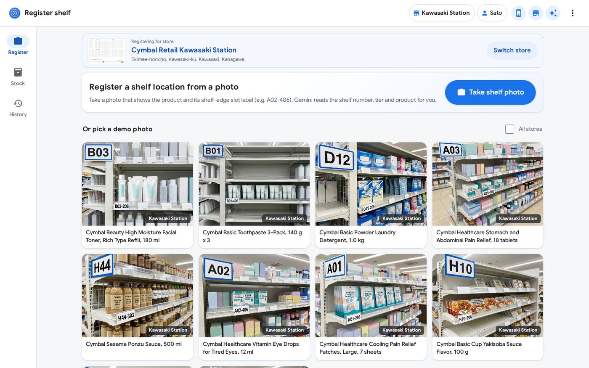 | 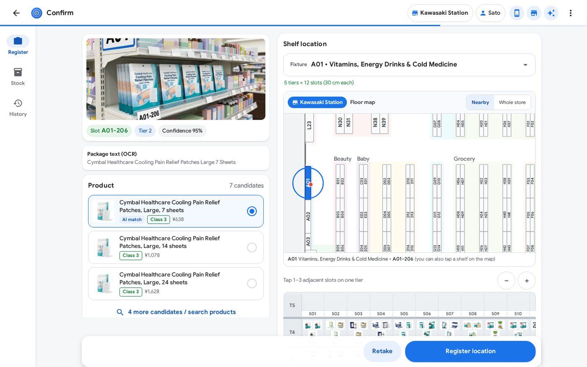 |

**3. Synced to AI Commerce Search Local Inventory**

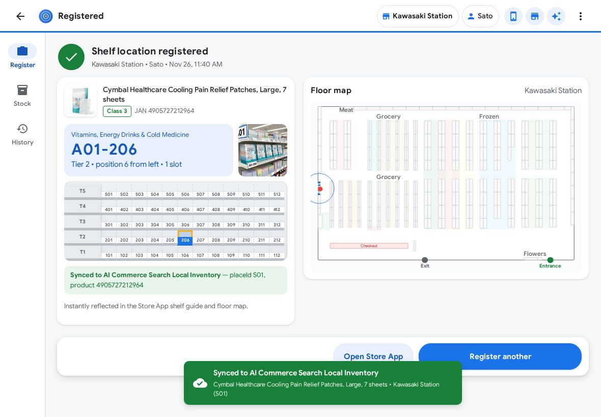

Staff don't type anything:

1. **Take a shelf photo** (or pick one of the demo photos). The store and staff member are chosen at sign-in.
2. **Gemini vision** reads the **shelf label** (e.g. `A01-206`, tier 2, slot) and the product package (OCR text), then
   proposes matching catalog products with a confidence score. The fixture and slot are highlighted on the store floor
   map, and staff can tap adjacent slots to adjust.
3. **Register location**: the app writes the shelf slot to BigQuery and calls Retail **`addLocalInventories`** in real
   time (`shelf_id`, `slot_ids`, `tier`, quantity, availability, `pickup-in-store`). A toast confirms **"Synced to
   AI Commerce Search Local Inventory"**. Within seconds, the shopper's Store App and the Online Store show the new shelf.

The Stock and History tabs show stock levels and the registration log, which is stored as inventory events in BigQuery.

---

### 4. Shelf Manager (`/admin` on the staff service, PC)

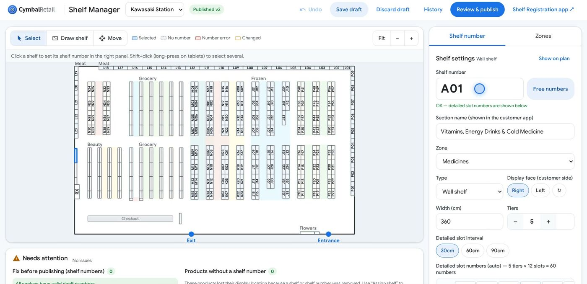

Store managers maintain the **floor plan** that the Store App uses for routes and shelf highlights:

- **Select / Draw shelf / Move** on the store floor plan (grocery, frozen, beauty, checkout, entrance and exit).
- For each shelf: **shelf number** (e.g. `A01`, with *Free numbers* suggestions), the **section name shown in the
  customer app**, **zone**, type (wall or gondola shelf), **display face**, width and **tiers**. **Detailed slot
  numbers** are generated automatically (e.g. 5 tiers × 12 slots = 60 numbers at a 30 cm interval).
- **Needs attention** checks before publishing: invalid shelf numbers, or products that lost their shelf because a
  shelf was removed.
- **Save draft → Review & publish** creates versioned layouts (`store_layouts` and `shelf_slots` in BigQuery), with
  history and undo. The customer app and the Shelf Registration app use the published version.

---

### 5. Data Enrichment Studio (`cymbal-data-enrichment`, PC)

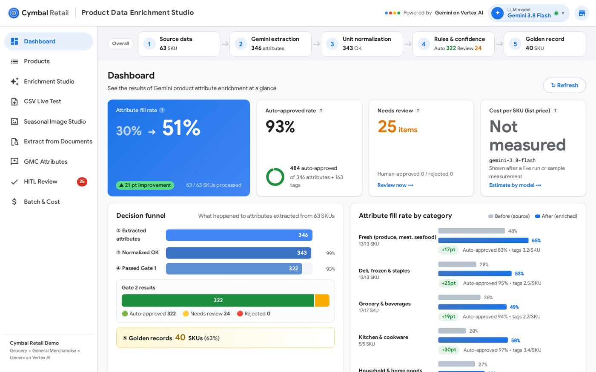

**Dashboard.** Merchandisers turn messy supplier data into clean product attributes with **Gemini on Vertex AI**. The
pipeline runs **Source data → Gemini extraction → Unit normalization → Rules & confidence → Golden records**. The
dashboard shows the attribute fill rate before and after enrichment (e.g. 30% → 51%), the auto-approval rate, the items
waiting for human review, the cost per SKU, a decision funnel, and the fill rate by category.

| Enrichment Studio (before / after, with evidence) | Human-in-the-loop review |
|---|---|
| 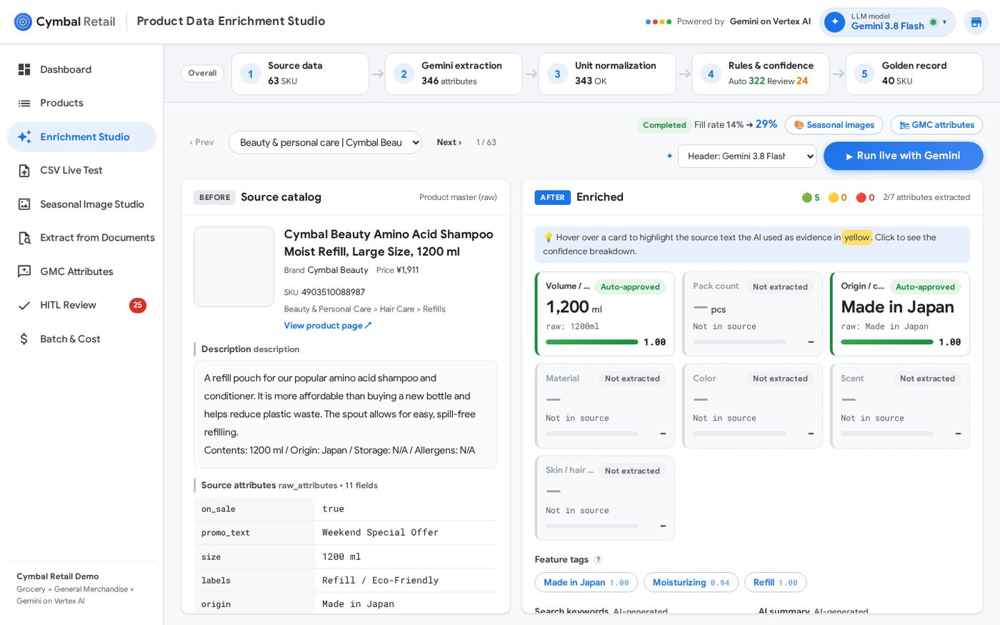 | 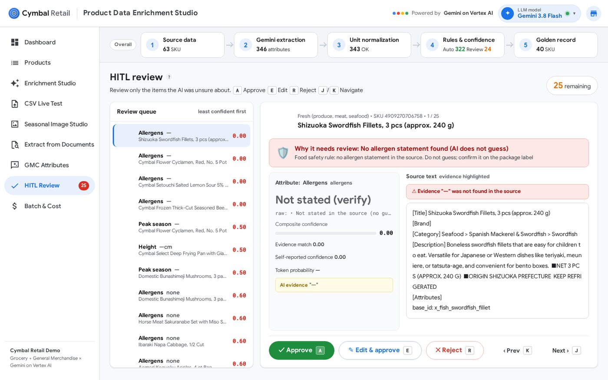 |

- **Studio**: pick a product and **Run live with Gemini**. The *Before* panel shows the source catalog record and the
  *After* panel shows the enriched attributes (volume, origin, allergens, storage, dishes, feature tags, search keywords).
  Each attribute has its **evidence** (hover to highlight the source text) and a confidence score. Gemini output is
  constrained by a JSON `responseSchema`. The **LLM model** picker in the header switches between the Gemini 3.x models
  available in the project.
- **Gates**: Gate 1 applies physical-limit, consistency and **food-safety (allergen)** rules. Gate 2 approves
  automatically when the composite score (evidence × 0.6 + self-confidence × 0.4) is 0.90 or higher. Gate 3 is the
  **HITL review** queue: approve, edit and approve, or reject, with keyboard shortcuts. Missing allergen statements are
  never guessed.

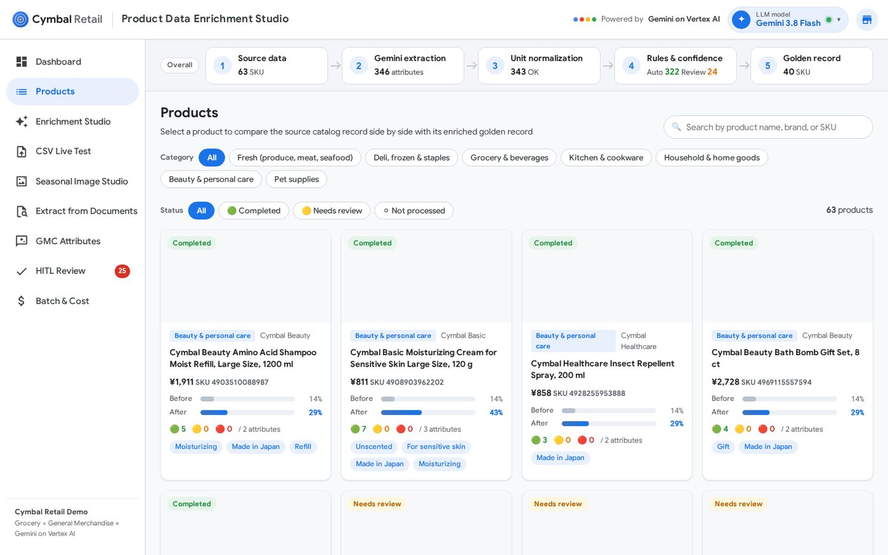

- **Products**: every SKU with its status (Completed, Needs review, Not processed) and its before/after attribute fill.
- The studio also covers **document extraction** (supplier spec PDFs, food-label photos, price-list spreadsheets),
  **CSV live test**, **Google Merchant Center conversational attributes**, a **seasonal image studio** (Gemini image
  models), and **Vertex AI Batch Prediction** with a cost estimate for the full catalog.
- Approved golden records are written to BigQuery (`cymbal_enrichment`). Optionally, they are **MERGEd** into
  `cymbal.products` after an automatic backup and re-imported into AI Commerce Search. Facets, relevance and
  the agent's answers then improve automatically.

---

## Data spine

| Store | Contents | Loaded by |
|---|---|---|
| AI Commerce Search `default_catalog` / branch `0` / serving config `default_search` | 3,000 English products (`channel` = `omni` / `store_only` / `online_only`, allergens, dishes, OTC drug class …), facet & attribute config, autocomplete | `50_catalog_import` (FULL import from GCS) |
| Retail **Local Inventory** | per product × store S01–S03: `quantity`, `availability`, `shelf_id`, `slot_ids`, `tier`, `pickup-in-store` | `50_catalog_import` (`store-navi/scripts/push_local_inventory.py`) and live from the staff app |
| BigQuery `cymbal` | `products` (+ `channel`), `autocomplete_suggestions`, `stores`, `store_layouts`, `shelf_slots`, `shelf_locations`, `store_inventory`, `store_inventory_events`, `store_coupons`, `store_offers`, `customers`, `purchase_history` | `40_data` (seed) + `50_catalog_import` (products) |
| BigQuery `cymbal_enrichment` | 63-SKU Enrichment Studio seed: `source_products`, `enriched_attributes`, `golden_records`, `gmc_conversational`, `sku_extras`, `batch_jobs`, plus runtime tables (`review_log`, `token_usage`, `product_images`, `doc_extractions`) | `40_data` |
| Cloud Storage | `<project>-catalog` (import files), `<project>-store-navi` (staff shelf photos), `products_images_<project>` (studio images) | `40_data` |
| Container images | 2,604 English packshots (served at `/img/products/` by the online store and the store app), staff demo photos | `70_apps` |

Seed files live in [`seed/`](seed/) and contain placeholders such as `__SITE_BASE_URL__`;
[`install/lib/render_seed.py`](install/lib/render_seed.py) renders them for your project into `install/.state/rendered/`
(the files in `seed/` are never modified). Details: [docs/DATA.md](docs/DATA.md).

---

## Quick start

**Prerequisites**: a Google Cloud project with billing enabled, `Owner` (or equivalent) on it, and a shell with
`gcloud` (incl. `bq`), `python3` ≥ 3.9 and `curl` — Cloud Shell works. A full install takes about **35–50 minutes**
(Cloud Build of 6 services + AI Commerce Search import + Local Inventory push).

### Option A — with Jetski (or any coding agent)

Open this repository in Jetski and ask:

> Install this demo into my project `<your-project-id>`.

The agent follows [`AGENTS.md`](AGENTS.md) and the bundled skill
[`_agents/skills/install-cymbal-demo`](_agents/skills/install-cymbal-demo/SKILL.md): it asks for the project and region,
runs the preflight and a dry run, runs the installer, handles the public-access step and verifies with the smoke test.
To re-brand or change data, ask for a customization — see
[`_agents/skills/customize-cymbal-demo`](_agents/skills/customize-cymbal-demo/SKILL.md).

### Option B — manually

```bash
git clone https://github.com/minsoojun-cloud/cymbal-retail-agentic-commerce-en-demo.git
cd cymbal-retail-agentic-commerce-en-demo
gcloud auth login && gcloud auth application-default login

cp install/config.example.env install/config.env
vi install/config.env                 # set PROJECT_ID (optionally REGION, SERVICE_PREFIX)

./install/install.sh --dry-run        # check the plan and the derived URLs
./install/install.sh -y               # install (idempotent; safe to re-run)
```

The installer runs these steps (each can be re-run alone with `--steps`, or resumed with `--from` / `--resume`):

| Step | What it does |
|---|---|
| `00_preflight` | CLIs, gcloud auth, project state, billing, seed files present |
| `10_apis` | enables Cloud Run, Cloud Build, Artifact Registry, Retail, Vertex AI, BigQuery, Storage, Speech, TTS … |
| `15_models` | checks the Gemini models answer in your project; records fallbacks in `install/.state/models.env` |
| `20_iam` | runtime service account `<prefix>-runtime` + roles; Cloud Build / source-deploy permissions |
| `30_retail` | accepts the AI Commerce Search data-use terms, enrolls *AI Commerce Search*, Retail service-agent roles |
| `40_data` | buckets, BigQuery datasets, renders and loads the BigQuery seed (stores, layouts, shelves, inventory, customers, purchase history, enrichment) |
| `50_catalog_import` | catalog → GCS → BigQuery `products` → AI Commerce Search FULL import → attributes config → autocomplete → Local Inventory for S01–S03 |
| `60_backend` | deploys the private MCP server, then the ADK agent |
| `70_apps` | deploys the online store, store app, staff app and Enrichment Studio (in parallel) |
| `80_public` | makes the 4 apps public: `allUsers` invoker, or — in orgs with *Domain Restricted Sharing* — `--no-invoker-iam-check` |
| `90_verify` | smoke test ([`tests/smoke_install.py`](tests/smoke_install.py)) and the URL summary |

At the end you get the URLs:

```text
Online store (PC / mobile) : https://<prefix>-site-<project-number>.<region>.run.app
Store app (phone / tablet) : https://<prefix>-store-app-<project-number>.<region>.run.app
Staff app (mobile)         : https://<prefix>-store-staff-<project-number>.<region>.run.app
Manager console (PC)       : https://<prefix>-store-staff-<project-number>.<region>.run.app/admin
Enrichment Studio          : https://<prefix>-data-enrichment-<project-number>.<region>.run.app
```

Re-deploy a single app after a code change: `source config.env && bash online-store/deploy.sh`
(or `SERVICE_NAME=$STORE_APP_SERVICE bash store-navi/deploy.sh`, `bash data-enrichment/deploy.sh`, …), or
`./install/install.sh --steps 70_apps`. Remove everything with `./install/uninstall.sh --all`.

Full guide: [INSTALL.md](INSTALL.md).

---

## Customization

| You want to change… | Where | Then run |
|---|---|---|
| Brand name, logo, colors | `online-store/static/img/logo.svg`, `online-store/static/css/theme.css`, `store-navi/static/shared/css/tokens.css` | `--steps 70_apps` |
| Products, prices, images | `seed/catalog/products_retail.jsonl` (+ images in `online-store/static/img/products/`) | `--from 50_catalog_import` |
| Personas, purchase history | `seed/personas/`, `seed/bigquery/cymbal/{customers,purchase_history}.jsonl.gz` | `--steps 40_data,60_backend,70_apps` |
| Stores, floor plans, shelves | `seed/bigquery/cymbal/{stores,store_layouts,shelf_slots,shelf_locations,store_inventory}.jsonl.gz`, `store-navi/data/` | `--steps 40_data,50_catalog_import,70_apps` (or edit live in `/admin`) |
| Agent behaviour / prompts | `shared/adk_agent/cymbal_agent/`, `store-navi/app/agent/` | `--steps 60_backend,70_apps` |
| Gemini models | `install/config.env` (`GEMINI_MODEL`, `AGENT_MODEL`, `ENRICH_GEMINI_MODEL`, `IMAGE_MODEL`) | `--from 15_models` |
| Service names / region | `install/config.env` (`SERVICE_PREFIX`, `REGION`) | full install |

Details: [docs/CUSTOMIZE.md](docs/CUSTOMIZE.md).

---

## Troubleshooting

| Symptom | Fix |
|---|---|
| `80_public` reports HTTP 401/403 | Your org blocks `allUsers` (*Domain Restricted Sharing*). The installer falls back to `--no-invoker-iam-check`; if that is blocked too (`run.managed.requireInvokerIam`), allow public access in the Cloud Console, or use `gcloud run services proxy <prefix>-site --region <region> --port 8080`. |
| `30_retail` acceptTerms / enroll fails | Open *AI Commerce Search* in the Cloud Console once and accept the data-use terms, then `--from 30_retail`. |
| Search returns nothing right after install | The AI Commerce Search import / index takes a few minutes. Re-check with `python3 tests/smoke_install.py` after `source config.env`. |
| "Available in stores" shows `source: bigquery` | Local Inventory not pushed yet: `source config.env && python3 store-navi/scripts/push_local_inventory.py --force`. |
| Gemini 404 / permission errors | `--from 15_models` records working fallbacks; or pin models in `install/config.env`. |
| A Cloud Build fails | See `install/.state/logs/<app>.log`, fix, and re-run `--steps 70_apps` (or `--from 60_backend`). |

More: [docs/TROUBLESHOOTING.md](docs/TROUBLESHOOTING.md).

---

## Repository layout

```text
install/                 one-shot installer (install.sh, uninstall.sh, steps/00…90, lib/, config.example.env)
config.env               derived runtime config (sourced by the installer and every deploy.sh — do not edit)
online-store/            cymbal-site: FastAPI + vanilla JS storefront, AI Concierge UI, product images
store-navi/              cymbal-store-app & cymbal-store-staff (one image, APP_MODE), /admin manager console
data-enrichment/         cymbal-data-enrichment: Product Data Enrichment Studio
shared/mcp_server/       cymbal-commerce-mcp: Commerce MCP server (private)
shared/adk_agent/        cymbal-adk-agent: ADK AI Concierge (private)
shared/catalog/          AI Commerce Search import, attribute config, autocomplete, verification scripts
seed/                    catalog (3,000 products), personas, BigQuery seed (cymbal, cymbal_enrichment)
tests/                   smoke_install.py (post-install), unit tests, brand/language guard
docs/                    architecture, data, customization, troubleshooting, README images
_agents/skills/          Jetski skills: install-cymbal-demo, customize-cymbal-demo
```

Cymbal Retail is a fictional brand used for Google Cloud demos. Product names, people and stores are fictional.
