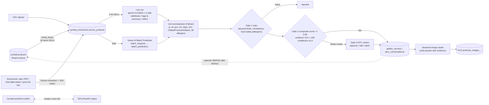

# Cymbal Retail Data Enrichment Studio

A demo that uses Gemini (Vertex AI) to take the Cymbal Retail product master (grocery + household goods,
`${PROJECT_ID}.cymbal.products`) through **extraction → unit normalization → 3-stage gating → golden records**, and also
covers Google Merchant Center (GMC) conversational attributes, seasonal promo images, and ingestion from documents
(spec sheets / food labels / price lists).

All project-specific values come from the environment (see [.env.example](.env.example) and
`config.env`); nothing below is tied to a specific project.

| Item | Value |
|---|---|
| Cloud Run | `cymbal-data-enrichment` (region `$REGION`, SA `cymbal-runtime`) → `$ENRICH_URL` |
| Storefront link | Header icon link "Store demo" → env `STORE_URL` (the storefront / ADK demo site URL) |
| Source (read / optional write) | `${PROJECT_ID}.cymbal.products` (Retail API schema). Before the first write of the day a CLONE backup `cymbal.products_backup_YYYYMMDD` is created, then changes are applied via staging + MERGE. The UI "update source" checkbox defaults to OFF |
| Enrichment results | BigQuery dataset `cymbal_enrichment` (env `ENRICH_BQ_DATASET`, location `BQ_LOCATION`) |
| GCS | `gs://products_images_${PROJECT_ID}` (env `IMAGE_BUCKET`, uniform access): generated images `{SKU}/…jpg`, documents `_docs_uploads/{date}/`, sample documents `_samples/` |
| Text model | **Selected with the "LLM model" picker in the header** (Gemini 3.x+, only models that answered a probe in this project; default `gemini-3.8-flash`, thinking LOW). Each screen can override it once. Falls back to `gemini-3.5-flash` only when busy, and the model actually used is shown in logs/results |
| Image model | `gemini-3.1-flash-image` (default) / `gemini-3-pro-image` (high quality) / `gemini-2.5-flash-image` (fallback on failure) |
| Batch | Vertex AI Batch Prediction (**selected model** @ global, BigQuery in/out; all 10 candidates verified). On failure the reason is shown and the user is pointed to a live run / `scripts/run_online.py` |

## LLM model selection and cost estimate (CONTRACT v6)

| Item | Implementation |
|---|---|
| Model list | Candidates in [app/models.py](app/models.py) (Gemini 3.x+ text models) are probed at startup with a `generateContent` ping @ global (cached 6 h). 2.x / image / TTS / Live are excluded; unavailable models are removed from the list |
| Propagation | Header picker (saved in `localStorage`) → `X-Enrich-Model` header on every request → `ModelMiddleware` → `models.current()`. Studio / CSV / GMC / document extraction each have a per-screen override |
| Batch support | On 2026-11-11 a 1-request BigQuery batch job was created for every candidate and reached `JOB_STATE_SUCCEEDED`. Unverified models get a disabled submit button with a reason |
| Measured tokens | 1 SKU = 3 calls (attributes / tags & summary / GMC). Input, output and thinking tokens are stored in BigQuery `cymbal_enrichment.token_usage` (live runs, CSV, document re-enrichment, sample measurement). Runs that fell back to another model are excluded |
| Sample measurement | Models without measurements are measured automatically on first view of "Batch & cost", or with the "Measure with 1 sample" button, using a representative SKU (median source length of the demo SKUs). Enrichment results are not overwritten |
| Prices | [app/pricing.py](app/pricing.py): the default is the **list price (no promotion applied)** from the [official pricing page](https://cloud.google.com/vertex-ai/generative-ai/pricing), Standard / Global / ≤200K tier (e.g. 3.8 Flash $1.50 / $7.50 per 1M tokens, Gemini 4 $4 / $20). Time-limited promotional (discounted) prices are shown only with the "Reference: promotional price" toggle (off by default). **Prices retrieved 2026-11-11.** Thinking tokens are billed at the output rate. Models without a price on the page show "See the official pricing page" and are excluded from totals. Batch / Flex / Priority prices and discounts are never used |
| Currency | **Costs are shown in USD** (`*_usd` fields). Every cost also has a `*_jpy` sibling converted with `USD_JPY` (env, default 150); the viewer can change the rate in the UI |

API: `GET /api/models`, `GET /api/cost/models?skus=&usd_jpy=&basis=list|promo`, `POST /api/cost/measure {model}` (SSE).
Response fields are documented in [docs/API.md](docs/API.md#cost-fields-usd).

## Architecture



| Principle | Implementation |
|---|---|
| JSON Schema enforced | `responseSchema` (attribute keys are an enum; evidence and confidence are required) [app/schema.py](app/schema.py) |
| Extraction separated from normalization | Gemini copies source values verbatim ("3 slices (approx. 240 g)") → conversion happens in [app/normalizer.py](app/normalizer.py) (240 g / 3 pcs) |
| Source grounding | Evidence snippets are string-matched against the source (exact 1.0 / fuzzy 0.8 / value only 0.5 / not found 0 → forced review) [app/rules.py](app/rules.py) |
| **Food safety (allergens)** | Allergens are auto-approved **only when an explicit label (e.g. "Allergens: ...") can be quoted verbatim**. Guesses, "none" coming only from structured attributes, a mandatory allergen in the product name (shrimp, crab, ...) but not declared, mismatch with source attributes, or no label → all go to HITL with a reason. HITL edits are validated against the 28-allergen list |
| Multi-stage | Stage 1 attribute extraction / Stage 2 normalization / Stage 3 standard tags, search keywords, summary / GMC conversational attributes |

Composite score = 0.6 × evidence match + 0.4 × self-confidence (0.5 / 0.3 / 0.2 when `avgLogprobs` is available).

### Category groups and attributes

| Group | Main attributes (golden record) |
|---|---|
| Fresh (produce, meat, fish) | Net weight (g), count, origin, storage method, allergens, season, uses / menu, cooking time |
| Deli, frozen & staples | Net content (g/ml), count, servings, origin, storage method, allergens, best-before (days), cooking time (min), cooking method, uses, flavor |
| Packaged food & drinks | Net content (g/ml), count, servings, origin, storage method, allergens, best-before, uses, flavor |
| Kitchen & cookware | Material, width/depth/height/diameter (cm), capacity (ml), count, color, induction-ready, dishwasher-safe, microwave-safe, country of manufacture |
| Household / beauty / pet | Material, size (cm), capacity, count, color, scent, skin type, target pet, target age, country of manufacture |

## Screens (9)

| Screen | Contents |
|---|---|
| Dashboard (`#/dashboard`) | Attribute fill rate before → after, auto-approval rate, pending reviews, cost per SKU (USD), gate funnel, per-category comparison |
| Products (`#/products`) | Filter by status / category, fill-rate bars |
| Enrichment studio (`#/studio/<SKU>`) | Source (Before) vs enriched (After) side by side. Hover highlights the evidence. "▶ Run live with Gemini" lights up each stage in turn |
| CSV live test (`#/csv`) | Enriches a product CSV (sample: frozen chicken tenders / autumn salmon / deep frying pan) in real time and saves to BigQuery |
| Seasonal image studio (`#/images/<SKU>`) | Autumn flavors, Winter hot pot, Year-end & New Year, New life, Summer chilled, Weeknight quick meals, E-commerce white background, Lifestyle, Sale. **Enabled only for products with evidence** (season months, hot-pot mention, on_sale, ...). Generates 2-4 images at once → saved to GCS / `product_images` (optionally also appended to `cymbal.products.images`) |
| Extract from documents (`#/docs`) | Spec PDF, food label photo, price list Excel / CSV → Gemini extraction → automatic SKU match by JAN → diff review → re-enrichment |
| GMC conversational attributes (`#/gmc/<SKU>`) | Generates, verifies, edits and exports (TSV/CSV) [Merchant Center conversational attributes](https://support.google.com/merchants/answer/17085370?hl=en) (Q&A, variant_option, product_highlight, ...). Allergy Q&A needs review unless the label is quoted |
| HITL review (`#/reviews`) | Items needing review with reasons (food-safety rule / no evidence / normalization failed / low confidence). Approve (A) / Edit (E) / Reject (R) |
| Batch & cost (`#/batch`) | **Per-model list-price (standard online) cost estimate in USD** (measured tokens × official unit price, SKU-count slider / presets, adjustable FX rate for the JPY reference, "Measure with 1 sample"), Vertex AI Batch jobs, golden-record CSV |

### Demo data (42 SKUs, [scripts/demo_skus.json](scripts/demo_skus.json))

Sakura Tanaka's (CR-0001, kids have a shrimp allergy) dinner sets (Pacific saury, corn, shimeji, miso soup, apple /
chicken thigh for karaage, napa cabbage / medium-hot curry roux, microwavable rice), products containing shrimp or crab
(sweet shrimp, hairy crab, shrimp pilaf, chili shrimp, New Year's Eve soba, shrimp crackers), seasonal items, and
kitchen, household, beauty and pet products.
6 of them are `sparse`: only the enrichment copy has its structured attributes removed and its description rewritten
in a messy legacy style (e.g. "■NET 3 SLICES (APPROX. 240G)  KEEP REFRIGERATED"), to show the effect of extraction
(fill rate 0% → 50%+) and the "never guess without a label" behavior. `cymbal.products` itself is never modified.

Sample documents (fictional data, [samples/docs](samples/docs), also uploaded to `gs://…/_samples/`):
`spec_cymbal_frypan_20cm.pdf` (JAN 4954950777214), `label_cymbal_carbonara.png` (allergen box: wheat, egg, milk,
soybean, pork), `price_list_2026winter_nabe.xlsx` (winter hot-pot fair: 4 existing JAN rows + 1 new row).
Regenerate with `python scripts/make_samples.py`.

## Setup

```bash
cd data-enrichment
source ../config.env                     # PROJECT_ID etc. (BQ_DATASET / GEMINI_MODEL are overridden by ENRICH_* so they never collide)
python3 -m venv /tmp/enrich-venv && /tmp/enrich-venv/bin/pip install -r requirements.txt
# 1) create dataset + tables and seed the 42 demo SKUs into source_products (--reset clears the result tables)
PYTHONPATH=. /tmp/enrich-venv/bin/python scripts/setup_bq.py --reset
# 2) enrich everything online (42 SKUs ≈ 50 s; prints the list-price cost in USD)
PYTHONPATH=. /tmp/enrich-venv/bin/python scripts/run_online.py --concurrency 6
# 3) (optional) Vertex AI Batch
PYTHONPATH=. /tmp/enrich-venv/bin/python scripts/submit_batch.py --limit 10
PYTHONPATH=. /tmp/enrich-venv/bin/python scripts/refresh_batch.py
# 4) deploy to Cloud Run (SA cymbal-runtime, --allow-unauthenticated)
./deploy.sh
```

Environment variables read by [app/config.py](app/config.py) are listed in [.env.example](.env.example).
Local run: `PYTHONPATH=. uvicorn app.main:app --port 8090` (`?mock=1` shows a mock UI without a backend).

Required IAM (`cymbal-runtime`): `roles/aiplatform.user`, `roles/bigquery.jobUser`,
`roles/bigquery.dataEditor` on datasets `cymbal_enrichment` and `cymbal` (source updates / backups),
`roles/storage.objectAdmin` on the image bucket.

## Tests

```bash
PROJECT_ID=test PYTHONPATH=. python -m pytest -q tests          # offline (Gemini / GCS / BQ are stubbed)
python tests/e2e/smoke_deployed.py "$ENRICH_URL" <OUT_DIR> [--token "$(gcloud auth print-identity-token)"]   # deployed smoke test
```

- [tests/test_normalizer.py](tests/test_normalizer.py): g/ml/pcs/servings/days/min/cm, Chilled/Frozen/Ambient, 28 allergens, season months
- [tests/test_rules.py](tests/test_rules.py): evidence matching, composite score, 3-stage gate, allergen evidence rules (guess / none / product name / mismatch / no label)
- [tests/test_api.py](tests/test_api.py): full API (grocery + general merchandise), HITL (allergen edit validation), GMC, header links
- [tests/test_models_cost.py](tests/test_models_cost.py): model candidate filtering (3.x+, unavailable excluded), list-price math (thinking = output rate), N-SKU extrapolation, missing prices, `X-Enrich-Model` propagation, sample measurement
- [tests/e2e/e2e_v6.py](tests/e2e/e2e_v6.py): Playwright (ID token attached only to the deployed origin): model selection → live run uses that model, per-model price table and official links, sample measurement
- [tests/test_images_docs.py](tests/test_images_docs.py): preset evidence gate, image generate/save/delete, document merge and JAN matching, numeric attribute protection on source updates

API spec: [docs/API.md](docs/API.md) / [docs/API_images_docs.md](docs/API_images_docs.md)

## Design notes

- Domain: grocery + household goods (7 groups, g/ml/pcs/cm/days/min, storage method, 28 allergens, season)
- Food-safety gate (allergens), also applied to allergy answers in GMC Q&A
- Seasonal presets for Cymbal (autumn flavors, winter hot pot, year-end, new life, summer chilled, quick meals, e-commerce white background, lifestyle, sale). "Sale" requires `on_sale` / promo copy as evidence
- Source table `cymbal.products` (backup `products_backup_YYYYMMDD`). Source updates from the UI default to OFF (the storefront and MCP server share the table)
- Env collision avoidance: `ENRICH_BQ_DATASET` / `ENRICH_GEMINI_MODEL` (never accidentally use `BQ_DATASET=cymbal` from the shared `config.env`; startup fails if both datasets are the same)
- Text-model fallback (3.8-flash → 3.5-flash), image-model fallback (→ 2.5-flash-image)
- Batch also includes the GMC conversational-attribute request (1 SKU = 3 requests); job error reasons are stored
- GMC `document_link` only when the source contains a URL (no invented URLs); `item_group_id` = source `base_id`
- Branding: Cymbal Retail × Google Cloud (white header, #1a73e8), header link to the store demo
