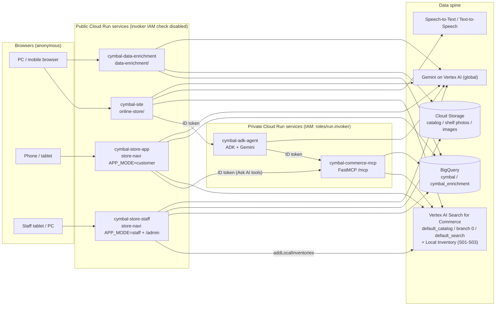
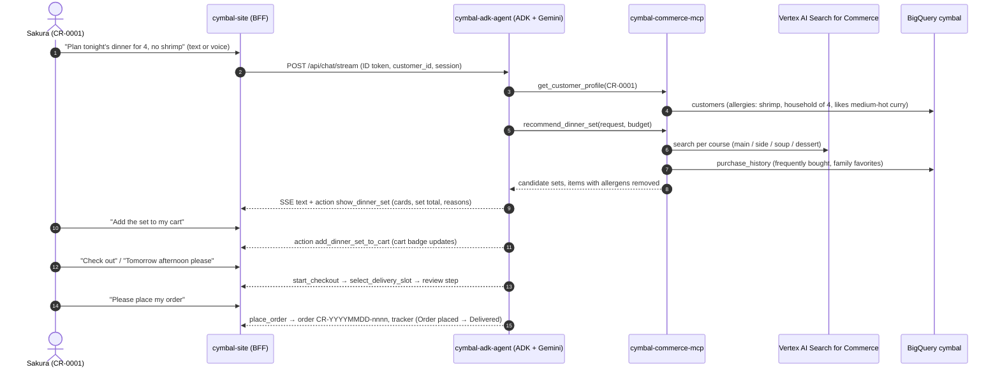
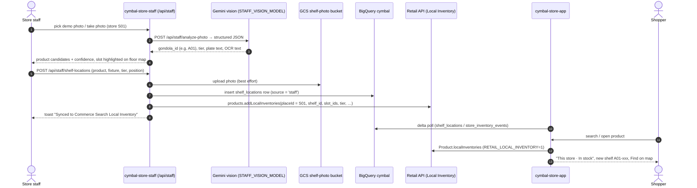
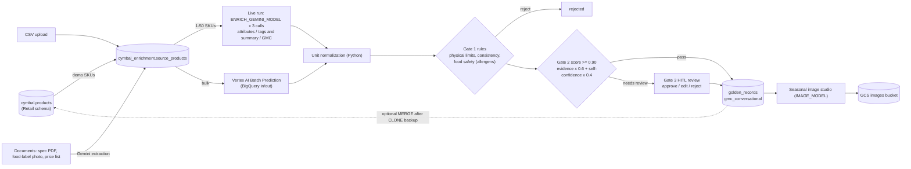
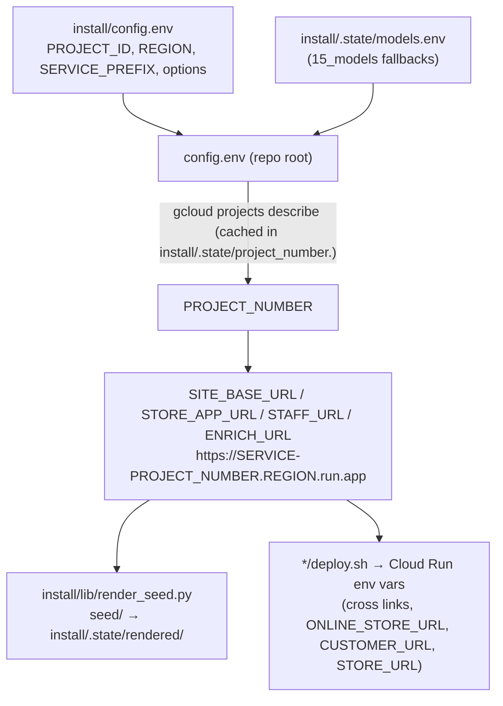

# Architecture (`docs/ARCHITECTURE.md`)

This document describes how the Cymbal Retail Agentic Commerce demo (English edition) is built: the six Cloud Run
services and their security boundary, the main use-case sequences, how service URLs are derived and cross-linked, and the
canonical environment variables. For data and schemas see [DATA.md](DATA.md). For installation see
[../INSTALL.md](../INSTALL.md).

> [!NOTE]
> Placeholders: `<PROJECT_ID>`, `<PROJECT_NUMBER>` and `<REGION>` stand for your values. With the default
> `SERVICE_PREFIX=cymbal`, the service names below are exactly what `install/install.sh` deploys.

---

## 1. Services and the security boundary

| Cloud Run service | Source | Access | Scaling (deploy.sh) | Role |
|---|---|---|---|---|
| `cymbal-commerce-mcp` | `shared/mcp_server/` | **private** (`--no-allow-unauthenticated`) | min 1 / max 5 | Commerce MCP server (FastMCP, streamable HTTP at `/mcp`): `search_products`, `get_product_details`, `compare_products`, `get_customer_profile`, `get_purchase_history`, `recommend_dinner_set`, `check_store_inventory` |
| `cymbal-adk-agent` | `shared/adk_agent/` | **private** | min 1 / max 1 | AI Concierge for the online store: an ADK (Agent Development Kit) agent on Gemini (`AGENT_MODEL`). It calls the MCP server and returns SSE events (text, cards, page actions) |
| `cymbal-site` | `online-store/` | public | min 1 / max 5 | Online store (PC and mobile web): search, AI Overview, facets, "Pick up in store", "Available in stores", cart, checkout, orders, voice. Backend-for-frontend proxy to the ADK agent |
| `cymbal-store-app` | `store-navi/` (`APP_MODE=customer`) | public | min 1 / max 3, session affinity | Store App for shoppers (phone and tablet): live stock, floor map and route, recipes, "Forgot something?", in-process AI Concierge ("Ask AI") |
| `cymbal-store-staff` | `store-navi/` (`APP_MODE=staff`) | public | min 1 / max 3, session affinity | Staff App (shelf-photo registration with Gemini vision, stock, history) and Shelf Manager at `/admin` |
| `cymbal-data-enrichment` | `data-enrichment/` | public | min 0 / max 1 | Product Data Enrichment Studio (Gemini extraction, gates, HITL review, GMC attributes, images, batch and cost) |

All six services run as one **runtime service account**, `${SERVICE_PREFIX}-runtime@<PROJECT_ID>.iam.gserviceaccount.com`.
Step `20_iam` grants it `retail.editor`, `bigquery.dataEditor`, `bigquery.jobUser`, `storage.objectAdmin`,
`aiplatform.user`, `run.invoker`, `logging.logWriter`, `monitoring.metricWriter`, `cloudtrace.agent`,
`iam.serviceAccountTokenCreator` and `serviceusage.serviceUsageConsumer`.

**The security boundary works like this:**

- **Private backends.** The MCP server and the ADK agent are deployed with `--no-allow-unauthenticated`. The runtime
  service account holds `roles/run.invoker`. Callers mint a Google **ID token** whose audience is the target URL, using
  the metadata server on Cloud Run (`google.oauth2.id_token.fetch_id_token`). Run locally, they fall back to
  `gcloud auth print-identity-token`. The browser never talks to these two services directly.
  - `online-store/app/agent_proxy.py`: browser → `POST /api/agent/stream` (site) → `POST ${ADK_AGENT_URL}/api/chat/stream`
    with `Authorization: Bearer <ID token>`. The SSE stream passes through unchanged.
  - `shared/adk_agent/cymbal_agent/mcp_client.py` and `store-navi/app/agent/mcp_client.py`: JSON-RPC to `${MCP_URL}/mcp`
    with an ID token, cached for about 45 minutes.
- **Public apps.** `online-store/deploy.sh`, `store-navi/deploy.sh` and `data-enrichment/deploy.sh` deploy with
  `--no-invoker-iam-check`, so the four apps are reachable without sign-in, which a stage demo needs. Step `80_public`
  checks `GET <url>/api/health` anonymously for each app. If an app does not answer with HTTP 200, the step first grants
  `roles/run.invoker` to `allUsers`. If an org policy (Domain Restricted Sharing, `iam.allowedPolicyMemberDomains`)
  rejects that binding, it sets `--no-invoker-iam-check` again. If the app is still not reachable, the step prints
  instructions and stops: allow public access in the Cloud Console, ask an org admin, or use
  `gcloud run services proxy`. The installer **never changes org policies**.
- **Nothing secret in the repo.** Credentials come from the runtime service account (ADC). `install/config.env` holds
  only the project id and options, and it is git-ignored.

---

## 2. Main use-case sequences

### 2.1 Online store: the AI Concierge plans a dinner set and places the order

The concierge (`shared/adk_agent/cymbal_agent/agent.py`, instruction `BASE_INSTRUCTION` plus per-session context)
reaches commerce data **only through MCP tools**. Page tools such as `show_dinner_set`, `show_products_on_page`,
`show_store_availability`, `add_dinner_set_to_cart`, `start_checkout`, `select_delivery_slot` and `place_order` return
**page actions**. The site's JavaScript (`online-store/static/js/chat*.js`) applies them to the page, so the chat and
the page stay in sync.

For store-only items, the same agent calls `find_store_stock` (MCP `check_store_inventory`) and returns
`show_store_availability`. The site opens the **Available in stores** modal. Its data comes from
`GET /api/products/{id}/stores`, which reads Retail `Product.localInventories` (`source: "retail_local_inventory"`)
joined with `cymbal.stores` (address, hours, *Open now*). If Retail is unavailable, it falls back to BigQuery
`store_inventory` (`source: "bigquery"`).

### 2.2 Store App: a staff shelf photo reaches the shopper's map

- `addLocalInventories` is **best effort and non-fatal**. The BigQuery row is the source of truth, and the response
  reports the Retail result in `local_inventory`.
- The Store App keeps an in-memory inventory index. It loads the full index at startup and then applies deltas in the
  background (`store-navi/app/inventory.py`), so a registration shows up within seconds without a redeploy.
- Store App **Ask AI** runs in the same process (`store-navi/app/agent/`): an embedded ADK `Runner` with the
  `store_concierge` agent (`AGENT_MODEL`) and an MCP client to `cymbal-commerce-mcp`. `safety.py` enforces the OTC rules
  on the server: a red-flag preface comes before any model text, there are no diagnoses, Class 1 medicines go to the
  pharmacist, and abuse-prone items are capped at one per customer. Each `done` event carries `trace`, which the UI shows
  as **"How I answered"**.
- The Shelf Manager (`/admin`, `store-navi/app/admin.py` and `layout_admin.py`) edits `store_layouts` and `shelf_slots`
  as versioned drafts. Publishing them makes the new layout the one the Store App and the staff app use.

### 2.3 Data Enrichment Studio: pipeline and quality gates

- Gemini output is constrained with a JSON `responseSchema` (`data-enrichment/app/schema.py`). Attribute keys are an
  enum, and evidence and confidence are required fields.
- The header's **LLM model** picker lists only the Gemini 3.x models that answered a probe in your project
  (`data-enrichment/app/models.py`). Token usage and cost (USD, with a JPY rate you can change) are recorded in
  `cymbal_enrichment.token_usage`.
- Writing back to `cymbal.products` is **off by default**. When it is turned on, the studio first creates a CLONE
  backup (`products_backup_YYYYMMDD`) and then applies a staging table plus a MERGE. Re-importing the catalog into
  Retail (`./install/install.sh --from 50_catalog_import`) makes the enriched attributes searchable.
- The service runs with `max-instances=1` because it keeps an in-memory cache that is persisted to BigQuery.

---

## 3. Deterministic URLs and cross links

Cloud Run gives each service a deterministic URL, `https://<service>-<PROJECT_NUMBER>.<REGION>.run.app`. The repo-root
**`config.env`** (derived configuration, sourced by every installer step and every `deploy.sh`; **never edit it**)
uses this to compute every URL **before** anything is deployed. That is why the four apps can be deployed in parallel
and still link to each other.

- **Seed placeholders.** The files in `seed/` contain no project values. `render_seed.py` replaces `__SITE_BASE_URL__`,
  `__STORE_APP_URL__`, `__STAFF_URL__`, `__ENRICH_URL__`, `__PROJECT_ID__` and `__PROJECT_NUMBER__`. It also rewrites any
  legacy absolute `https://<prefix>-site-<number>.<region>.run.app` URL, so a catalog exported from another installation
  can be dropped in unchanged. The output goes to `install/.state/rendered/`, and `seed/` is never modified. `config.env`
  re-renders automatically when the project, URLs or `seed/catalog/products_retail.jsonl` change (stamp file
  `install/.state/rendered/.stamp`).
- **Product URLs.** Product `uri` is `${SITE_BASE_URL}/?product=<id>` and images are
  `${SITE_BASE_URL}/img/products/<file>`. The online store serves the 2,600+ product images from
  `online-store/static/img/products/`, and the Store App serves the same files under `/img/products/`.
- **Cross links.** Each app header has 36 px round icon links with tooltips: site ↔ Store App ↔ Staff App ↔ Enrichment
  Studio. The Store App's **Buy online** opens `${ONLINE_STORE_URL}/?product=<id>`.
- **Backend URLs.** `MCP_URL` and `ADK_AGENT_URL` are read from the deployed services after `60_backend`.
  `shared/adk_agent/deploy.sh` writes `shared/adk_agent/DEPLOYMENT.env`, and `online-store/deploy.sh` reads it.

---

## 4. Canonical environment variables (`install/config.env` → `config.env`)

Values you set go in `install/config.env` (template: `install/config.example.env`). Variables you export in your shell
always override the file. Everything else is derived.

| Variable | Set by | Default / derivation | Used by |
|---|---|---|---|
| `PROJECT_ID` | **you** (required) | none | everything |
| `REGION` | you | `asia-northeast1` | Cloud Run, BigQuery, GCS |
| `SERVICE_PREFIX` | you | `cymbal` | service names, runtime SA name |
| `RUNTIME_SA_NAME` / `RUNTIME_SA` | you / derived | `${SERVICE_PREFIX}-runtime` / `…@${PROJECT_ID}.iam.gserviceaccount.com` | all services |
| `PROJECT_NUMBER` | derived | `gcloud projects describe` (cached) | URLs, Retail catalog path |
| `BQ_DATASET` / `BQ_TABLE` / `BQ_LOCATION` | you / derived | `cymbal` / `products` / `${REGION}` | MCP, site, store-navi, loaders |
| `ENRICH_BQ_DATASET` | you | `cymbal_enrichment` | Enrichment Studio |
| `GCS_BUCKET` (`CATALOG_BUCKET`) | you / derived | `${PROJECT_ID}-catalog` | catalog import files |
| `PHOTO_BUCKET` (`STORE_NAVI_BUCKET`) | you / derived | `${PROJECT_ID}-store-navi` | staff shelf photos |
| `IMAGE_BUCKET` (`ENRICH_IMAGE_BUCKET`) | you / derived | `products_images_${PROJECT_ID}` | Enrichment images and documents |
| `SITE_SERVICE`, `STORE_APP_SERVICE`, `STAFF_SERVICE`, `ENRICH_SERVICE`, `ADK_SERVICE`, `MCP_SERVICE` | derived | `${SERVICE_PREFIX}-site`, `-store-app`, `-store-staff`, `-data-enrichment`, `-adk-agent`, `-commerce-mcp` | deploy scripts |
| `SITE_BASE_URL` (= `ONLINE_STORE_URL`, `STORE_URL`) | derived | `https://${SITE_SERVICE}-${PROJECT_NUMBER}.${REGION}.run.app` | catalog URIs, cross links |
| `STORE_APP_URL` (= `CUSTOMER_URL`), `STAFF_URL`, `ENRICH_URL` | derived | same pattern | cross links |
| `ADK_AGENT_URL`, `MCP_URL` | derived | same pattern / read after deploy | site BFF, agents |
| `GEMINI_MODEL` | you / probed | `gemini-3-flash-preview` | search query understanding, store app helpers |
| `AGENT_MODEL` | you / probed | `gemini-3.5-flash` | ADK AI Concierge, Store App "Ask AI" |
| `ENRICH_GEMINI_MODEL` | you / probed | `gemini-3.8-flash` | Enrichment extraction |
| `GEMINI_FALLBACK_MODEL` | probed | `gemini-3.5-flash` | Enrichment fallback when busy |
| `IMAGE_MODEL` | you / probed | `gemini-3.1-flash-image` | Enrichment image studio |
| `GEMINI_LOCATION` | you | `global` | all Gemini calls |
| `VOICE_ENABLED` | you | `1` | online store voice (Speech-to-Text Chirp, TTS `en-US-Chirp3-HD-Aoede`) |
| `LANGUAGE_CODE` / `CURRENCY_CODE` | fixed / you | `en` / `JPY` | catalog |
| `CATALOG_JSONL` / `AUTOCOMPLETE_JSONL` | derived | `install/.state/rendered/catalog/…` | 50_catalog_import, deploys |

Service-specific switches set by the deploy scripts include `APP_MODE` (`customer` | `staff`), `DATA_MODE` (`bq` on
Cloud Run, `local` for JSON files), `RETAIL_LOCAL_INVENTORY=1`, `AGENT_BACKEND=adk` (or `mock`),
`AGENT_MODE` (store app live or mock) and `STAFF_VISION_MODEL`.

> [!TIP]
> Model fallbacks: step `15_models` (`install/lib/probe_models.py`) sends a one-line `generateContent` to each
> configured model. When a **default** model does not answer, it writes the first working fallback to
> `install/.state/models.env` as `PROBED_<ROLE>`. A model you pinned in `install/config.env` is never replaced.
