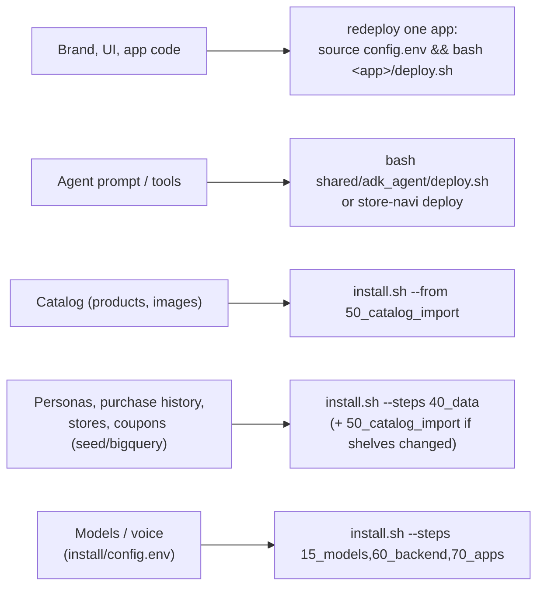

# Customization guide (`docs/CUSTOMIZE.md`)

This guide shows how to adapt the installed demo for a customer: their brand, products, shopper persona, stores, and
the AI agents' instructions and models. For each change it tells you the **smallest re-run** that applies it. Coding
agents follow the same recipes in
[`_agents/skills/customize-cymbal-demo/SKILL.md`](../_agents/skills/customize-cymbal-demo/SKILL.md).

> [!IMPORTANT]
> - Change settings in `install/config.env`. Never edit the root `config.env`, which is derived.
> - Keep `seed/` project-independent. Product URLs stay `__SITE_BASE_URL__/...`, and the installer renders them for your
>   project into `install/.state/rendered/`.
> - Keep everything user-visible in English (or the customer's language, consistently). Never use real retailer or
>   manufacturer names in demo data unless the customer provided and approved them.

---

## 1. Partial re-runs (`--steps`, `--from`, single-app redeploy)



| What you changed | Re-run |
|---|---|
| Online-store UI (HTML/CSS/JS, logo) | `source config.env && bash online-store/deploy.sh` |
| Store App or Staff App UI | `source config.env && SERVICE_NAME=$STORE_APP_SERVICE bash store-navi/deploy.sh` (or `$STAFF_SERVICE`) |
| Enrichment Studio UI | `source config.env && bash data-enrichment/deploy.sh` |
| Online-store concierge prompt or tools (`shared/adk_agent`) | `source config.env && bash shared/adk_agent/deploy.sh` |
| MCP tools (`shared/mcp_server`) | `./install/install.sh --steps 60_backend` |
| Store App agent prompt (`store-navi/app/agent`) | redeploy `store-app` (see above) |
| Catalog `seed/catalog/products_retail.jsonl` or product images | `./install/install.sh --from 50_catalog_import` |
| BigQuery seed (`seed/bigquery/**`) | `./install/install.sh --steps 40_data` |
| Store layouts, shelves or inventory (`store-navi/data`) | `./install/install.sh --steps 40_data,50_catalog_import,70_apps` (see section 5) |
| Models, voice (`install/config.env`) | `./install/install.sh --steps 15_models,60_backend,70_apps` |

---

## 2. Brand name, logo and theme colors

### 2.1 Brand name

The wordmark **"Cymbal Retail"** appears in the HTML of each app and in some agent and server strings. Find every
occurrence and replace it:

```bash
grep -rn "Cymbal Retail" online-store/static store-navi/static data-enrichment/static \
  shared/adk_agent/cymbal_agent store-navi/app online-store/app data-enrichment/app
```

The catalog also uses the **Cymbal** brand lines (`Cymbal Basic`, `Cymbal Select`, `Cymbal Organic`, `Cymbal`) in
product titles, `brands` and the `brand_line` attribute. Change those in the catalog (section 3) if the customer wants
their own private labels.

### 2.2 Logos and color tokens

| App | Logo | Colors and theme |
|---|---|---|
| Online store (`online-store/`) | `static/img/logo.svg`, `static/img/favicon.svg`, plus the inline SVG wordmark in `static/index.html` (`.cr-logo`) | `static/css/theme.css`: CSS variables `--cr-blue`, `--cr-text`, `--cr-green`, `--cr-red`, `--cr-yellow`, … |
| Store App, Staff App, Shelf Manager (`store-navi/`) | `static/shared/img/logo.svg`, `static/shared/img/favicon.svg` | `static/shared/css/` (shared tokens), plus `static/customer/`, `static/staff/` and `static/admin/` |
| Enrichment Studio (`data-enrichment/`) | header in `static/index.html` | `static/css/` |

Keep the CSS variable names and change only their values. Every component then picks up the new palette.

### 2.3 Apply

```bash
source config.env
bash online-store/deploy.sh
SERVICE_NAME=$STORE_APP_SERVICE bash store-navi/deploy.sh
SERVICE_NAME=$STAFF_SERVICE bash store-navi/deploy.sh
bash data-enrichment/deploy.sh
# or all four in parallel:
./install/install.sh --steps 70_apps -y
```

---

## 3. Replace or add products (catalog)

The catalog is one file: **`seed/catalog/products_retail.jsonl`**. It has one Retail `Product` JSON per line
(`type: PRIMARY`, `languageCode: "en"`, `priceInfo.currencyCode: "JPY"`, tax-included prices). The installer renders it,
loads BigQuery `cymbal.products`, runs a Retail FULL import, and the apps bundle it at deploy time.

### 3.1 Product record

```json
{
  "id": "4983502033621",
  "type": "PRIMARY",
  "title": "Cymbal Select Frozen Osechi New Year Box, 3-Tier, 40 Items, Serves 4-5",
  "brands": ["Cymbal Select"],
  "categories": ["Deli & Meal Kits > Osechi & New Year Foods > Osechi (New Year Dishes)"],
  "languageCode": "en",
  "attributes": [
    {"key": "channel",      "value": {"text": ["omni"]}},
    {"key": "allergens",    "value": {"text": ["egg", "milk", "shrimp", "wheat"]}},
    {"key": "storage_type", "value": {"text": ["Frozen"]}},
    {"key": "dishes",       "value": {"text": ["osechi (New Year dishes)", "Celebration"]}}
  ],
  "priceInfo": {"currencyCode": "JPY", "price": 26784.0, "originalPrice": 26784.0},
  "availability": "IN_STOCK",
  "uri": "__SITE_BASE_URL__/?product=4983502033621",
  "images": [{"uri": "__SITE_BASE_URL__/img/products/y_seasonal_event_frozen_osechi_jubako_p.jpg", "width": 600, "height": 600}]
}
```

Rules that the apps and agents depend on:

- **`channel`** is one of `omni` (online and in stores), `store_only` (deli, sushi, in-store bakery, flowers,
  pharmacist-only medicine…) or `online_only` (bulk and large items). It drives the "In-store only" and "Online only"
  badges, the "Available in stores" modal and the Local Inventory push. The current mix is 2,532 omni, 285 store-only
  and 183 online-only.
- **`allergens`** use English names (`shrimp`, `crab`, `wheat`, `egg`, `milk`, `peanut`, `buckwheat`, `walnut`…). The
  concierge's allergy guard filters on them.
- Categories use the top-level names in `shared/catalog/category_map_en.json` (`Produce`, `Seafood`, `Meat`,
  `Deli & Meal Kits`, …, `Health & Medicine`, `Flowers`).
- Other useful attributes: `on_sale`, `discount_rate`, `is_seasonal`, `size`, `origin`, `labels`, `brand_line`,
  `promo_text`. For OTC medicine: `drug_class`, `symptoms`, `age_min`. Facets and filters are configured in
  `shared/catalog/set_attributes_config.py`.
- `uri` and `images[].uri` **must** start with `__SITE_BASE_URL__`. Never write a real Cloud Run URL. `render_seed.py`
  rewrites legacy absolute `…-site-<number>.<region>.run.app` URLs too, so a catalog exported from another installation
  can be dropped in unchanged.

### 3.2 Product images

Put each image (600×600 JPEG, white background recommended) in **`online-store/static/img/products/`** and reference it
as `__SITE_BASE_URL__/img/products/<file>`. The online store serves the folder, and `store-navi/deploy.sh` copies the
same images into the store app. Use images that you have the rights to, such as the customer's own product shots or
images you generate. The Enrichment Studio image studio can generate seasonal promo images with Gemini image models.

### 3.3 Validate and apply

```bash
python3 shared/catalog/validate_jsonl.py seed/catalog/products_retail.jsonl
./install/install.sh --from 50_catalog_import -y
```

`--from 50_catalog_import` does the following:

1. Re-renders the catalog.
2. Reloads `cymbal.products`.
3. Runs the Retail FULL import, which removes products that are no longer in the file.
4. Re-applies the attribute config and autocomplete.
5. Re-pushes Local Inventory.
6. Redeploys the backends and apps, then verifies.

If you add new **store-only** or **omni** products, also give them shelf slots and stock (section 5). Otherwise they
show as unavailable in stores. Keep `seed/catalog/autocomplete_suggestions.jsonl` and
`seed/catalog/recipes_en.json` consistent with the catalog. Recipe ingredients reference `product_id`s that must exist.

---

## 4. Shopper persona, allergies and purchase history

The demo shopper is **CR-0001 Sakura Tanaka**: a family of 4 (Sakura, Ken, Yui 9 and Haru 6), with a shrimp allergy
(the kids) and a liking for medium-hot curry. CR-0002 Hiroshi Sato and CR-0003 Mika Ito are store-app personas.

| Data | Where it lives | Used by |
|---|---|---|
| Customer profiles | `seed/bigquery/cymbal/customers.jsonl.gz` (3 rows, each with the full persona in `profile_json`). The source for CR-0001 is `seed/personas/personas.json`. | MCP `get_customer_profile`, store-app agent, recommendations |
| Purchase history | `seed/bigquery/cymbal/purchase_history.jsonl.gz` (808 rows). The source for CR-0001 is `seed/personas/purchase_history.jsonl`. | MCP `get_purchase_history`, "Did you forget?", "Frequently bought" tags |
| Local fallback copies | `shared/mcp_server/data/{personas.json,purchase_history.jsonl}` | MCP server when BigQuery is unavailable |
| Store-app copies | `store-navi/data/{store_personas.json,purchase_history.jsonl,store_purchase_history.jsonl}`, bundled at deploy | Store App "Last bought" and "Did you forget?", store personas |
| Signed-in customer | `online-store/app/main.py` (`CUSTOMERS`, `DEFAULT_CUSTOMER = "CR-0001"`, cookie `cr_customer`) | online store header and greeting |

To change the persona (for example a different family, allergy or favorite dishes):

1. Edit `seed/personas/personas.json` (`household`, `allergies`, `dislikes`, `family_preferences`,
   `favorite_products_keywords`, …). Keep `customer_id`. Product ids in the purchase history must exist in the catalog.
2. Write the same persona into the BigQuery seed. Decompress `seed/bigquery/cymbal/customers.jsonl.gz`, update the
   row (including `profile_json`), and recompress it. Do the same for `purchase_history.jsonl.gz` if the history changed.
3. Update the fallback copies in `shared/mcp_server/data/` and the store-app copies in `store-navi/data/`, and the
   display name in `online-store/app/main.py`.
4. Apply:
   ```bash
   ./install/install.sh --steps 40_data,60_backend,70_apps -y
   ```
   For a quick experiment, `seed/personas/load_to_bq.sh` loads `personas.json` and `purchase_history.jsonl` straight
   into BigQuery. A later `40_data` restores whatever is in `seed/bigquery/`.

The concierge's allergy behaviour ("As you told us before, I've left out anything containing shrimp.") is in the agent
instruction (section 6). Update the example wording if the allergen changes.

---

## 5. Stores, floor layouts, shelves, coupons (`store-navi`)

There are three stores: **S01** Cymbal Retail Kawasaki Station, **S02** Musashi-Kosugi and **S03** Shibuya.

### Option A: edit in the browser (no code)

- **Shelf Manager** (`<staff URL>/admin`, PC): draw and move shelves, set shelf numbers, section names, zones, tiers and
  slot intervals, then **Review & publish**. The layout is versioned in BigQuery (`store_layouts`, `shelf_slots`).
- **Staff App** (`<staff URL>`): register a product on a shelf from a photo. Each registration is written to BigQuery
  `shelf_locations` (`source='staff'`) and pushed to Retail Local Inventory immediately.

Re-running the installer keeps staff registrations. A re-run of `40_data` resets published layouts to the seed.

### Option B: rebuild the store data from definitions

```bash
# 1. Edit the store geometry and assortment rules
vi store-navi/scripts/store_layout_defs.py        # fixtures, aisles, planogram groups per store
vi store-navi/data/stores.json                    # names, addresses, hours, lat/lng
vi store-navi/data/coupons.json store-navi/data/offers.json

# 2. Rebuild layouts, inventory, slots and shelf locations (deterministic)
python3 store-navi/scripts/build_store_data.py all
python3 store-navi/scripts/gen_personas.py        # store personas and offers from the in-stock assortment

# 3. Load into BigQuery (keeps staff registrations) and re-push Local Inventory
source config.env
python3 store-navi/scripts/setup_bq.py --skip-iam
python3 store-navi/scripts/push_local_inventory.py --force
```

`push_local_inventory.py` reads `store-navi/data/store_inventory.jsonl` and `shelf_locations.jsonl`. To make the change
permanent for future installs, also update the matching `seed/bigquery/cymbal/<table>.jsonl.gz` files. For example,
export the tables after `setup_bq.py` with `bq extract --destination_format NEWLINE_DELIMITED_JSON --compression GZIP`.
Then redeploy the store app and staff app (`--steps 70_apps`), which bundle `store-navi/data`.

---

## 6. AI agent instructions and models

### 6.1 Online-store AI Concierge (`shared/adk_agent`)

- **Instruction**: `BASE_INSTRUCTION` in `shared/adk_agent/cymbal_agent/agent.py`. It has tagged sections such as
  `<allergy>` and `<greeting>`, plus dinner-set and reply-style rules. `build_instruction` adds the per-session
  customer context.
- **Tools**: `shared/adk_agent/cymbal_agent/tools.py`: `search_products`, `recommend_dinner_set`, `show_dinner_set`,
  `add_dinner_set_to_cart`, `find_store_stock`, `show_store_availability`, `add_to_cart`, `start_checkout`,
  `select_delivery_slot`, `place_order`, `get_order_status`, …. These call the Commerce MCP server
  (`shared/mcp_server/server.py`).
- Apply: `source config.env && bash shared/adk_agent/deploy.sh`.

### 6.2 Store App "Ask AI" (`store-navi/app/agent`)

- **Instruction**: `BASE_INSTRUCTION` in `store-navi/app/agent/agent.py`.
- **Health-safety policy** (no diagnosis, red-flag check, pharmacist hand-off for Class 1): `store-navi/app/agent/safety.py`.
- **Tools**: `store-navi/app/agent/tools.py`.
- Apply: `source config.env && SERVICE_NAME=$STORE_APP_SERVICE bash store-navi/deploy.sh`.

> [!WARNING]
> Keep the health-safety rules when you customize the Store App agent. The demo shows compliant OTC answers, and
> removing the guardrails changes that story.

### 6.3 Gemini models and voice

Set these in `install/config.env`, then run `./install/install.sh --steps 15_models,60_backend,70_apps`:

| Setting | Default | Used by |
|---|---|---|
| `GEMINI_MODEL` | `gemini-3-flash-preview` | online-store search helpers (AI Overview, query understanding), store app helpers |
| `AGENT_MODEL` | `gemini-3.5-flash` | ADK AI Concierge, Store App "Ask AI" |
| `ENRICH_GEMINI_MODEL` | `gemini-3.8-flash` | Enrichment Studio extraction (the header picker can switch it at runtime) |
| `IMAGE_MODEL` | `gemini-3.1-flash-image` | Enrichment Studio image studio |
| `GEMINI_LOCATION` | `global` | all Gemini calls |
| `VOICE_ENABLED` | `1` | concierge voice input (Speech-to-Text `en-US`) and read-aloud (Text-to-Speech Chirp 3 HD) |

If you leave a model empty, `15_models` verifies the default and records a working fallback when needed. A model that
you pin is always used as is.

---

## 7. Checklist after customizing

1. `./install/install.sh --steps 90_verify` passes.
2. Open the online store and run the demo script: dinner set with the allergy guard, a store-only item with
   **Available in stores**, and checkout.
3. Open the Store App on a phone (390×844) and a tablet (1180×820): search, Find on map, "Did you forget?" and Ask AI.
4. Register one shelf in the Staff App and confirm that the Store App shows the new shelf.
5. Check that no real project id, project number or `run.app` URL was written into `seed/` or source files:
   `grep -rnE "run\.app|<your-project-id>" seed shared online-store store-navi data-enrichment`.
