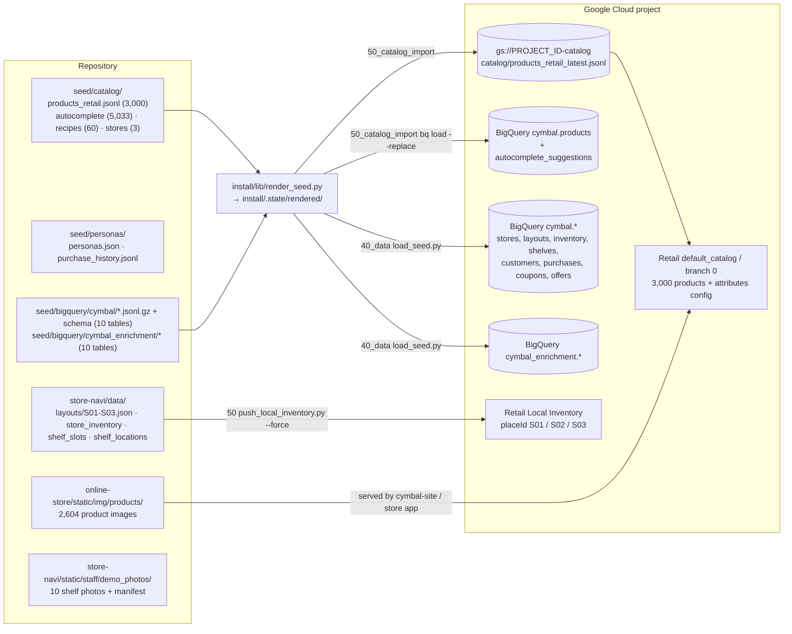

# Data and schema reference (`docs/DATA.md`)

This document lists every dataset the demo ships with and where it ends up in Google Cloud: the catalog and personas in
`seed/`, the BigQuery datasets `cymbal` and `cymbal_enrichment`, the store files in `store-navi/data/`, Retail **Local
Inventory**, and the Cloud Storage buckets. Row counts are the counts in this repository.

> [!NOTE]
> All seed files are **English** (`languageCode: "en"`, prices in **JPY**, tax included, Asia/Tokyo). They contain no
> project values. URLs are written as placeholders such as `__SITE_BASE_URL__`, and `install/lib/render_seed.py`
> renders them into `install/.state/rendered/` at install time. Do not write project-specific URLs into `seed/`.

---

## 1. Data map

---

## 2. Catalog, autocomplete, recipes, stores and personas (`seed/catalog/`, `seed/personas/`)

| File | Rows | Format | Contents |
|---|---:|---|---|
| `seed/catalog/products_retail.jsonl` | 3,000 | Retail `Product` JSON (PRIMARY) | English titles, descriptions, `categories` (22 top categories), `brands`, `priceInfo` (JPY), `rating`, `uri`/`images` with `__SITE_BASE_URL__`, custom attributes (below) |
| `seed/catalog/autocomplete_suggestions.jsonl` | 5,033 | `{suggestion, score}` | English autocomplete terms ("medium hot curry", "frozen bento", "dog food" …) → BigQuery `cymbal.autocomplete_suggestions` → Retail completion data |
| `seed/catalog/recipes_en.json` | 60 | JSON | Recipes for the Store App recipe concierge. Every ingredient `product_id` exists in the catalog |
| `seed/catalog/stores_en.json` | 3 | JSON | `S01` Cymbal Retail Kawasaki Station, `S02` Cymbal Retail Musashi-Kosugi, `S03` Cymbal Retail Shibuya |
| `seed/personas/personas.json` | 1 | JSON | Detailed persona **CR-0001 Sakura Tanaka**: family of 4 (Sakura, Ken, Yui 9, Haru 6), **shrimp allergy (kids)**, likes medium-hot curry |
| `seed/personas/purchase_history.jsonl` | 685 | JSONL | Sakura's online purchase history (`generate_history.py` regenerates it, and `load_to_bq.sh` loads it) |

**Channel mix** (`channel` attribute): `omni` 2,532 · `store_only` 285 · `online_only` 183.
- `store_only`: in-store bakery, sushi/sashimi, hot deli, flowers, pharmacist-only (Class 1) OTC, some fresh-cut
  produce. Each is in stock in at least one store.
- `online_only`: bulk pet food, large kitchen and home goods, cases of beverages. None is in any store.
- `omni`: everything else. Most are stocked in most stores.

**Top categories (products):** Deli & Meal Kits 239, Seasonings & Sauces 205, Produce 203, Meat 183, Seafood 171,
Frozen 165, Eggs & Dairy 156, Rice & Noodles 155, Health & Medicine 149, Pantry 147, Snacks & Sweets 144, Tofu & Natto 144,
Beverages 129, Household 122, Bakery 121, Beauty & Personal Care 102, Alcohol 94, Home & Living 93, Kitchen 85, Baby 85,
Pet 73, Flowers 35. The category mapping is fixed in `shared/catalog/category_map_en.json`.

**Custom attributes** (Retail `attributes`; `shared/catalog/set_attributes_config.py` configures which are searchable,
facetable and retrievable):

| Key | Type | Example / meaning |
|---|---|---|
| `top_category` | text | `Seafood` |
| `channel` | text | `omni` / `store_only` / `online_only` |
| `on_sale`, `is_seasonal`, `is_food` | text | `"true"` / `"false"` |
| `discount_rate`, `price_tax_excluded`, `original_price_tax_excluded`, `season_months` | numbers | `20`, `698`, `[9,10,11]` |
| `size`, `origin`, `storage_type` | text | `4 pcs`, `Hokkaido`, `Ambient` / `Chilled` / `Frozen` |
| `labels`, `dishes`, `allergens` | text (multi) | `Family favorite`; `curry`; `shrimp`, `wheat`, `egg`, `milk` … |
| `brand_line` | text | `Cymbal Basic` / `Cymbal Select` / `Cymbal Organic` / `Cymbal` |
| OTC: `drug_class`, `symptoms`, `age_min`, `abuse_control` | text / numbers | `Designated Class 2`, `fever`, `15` |
| `promo_text`, `material`, `color`, `capacity` | text | present on some products |
| `base_id`, `title_ja` | text | references only (not shown in the UI) |

---

## 3. BigQuery dataset `cymbal` (catalog 2 + seed 10 tables)

Step `40_data` (`install/lib/load_seed.py`) loads the seed tables. Step `50_catalog_import` builds `products` and
`autocomplete_suggestions` from the rendered catalog.

| Table | Rows | Source | Key columns / purpose |
|---|---:|---|---|
| `products` | 3,000 | rendered catalog + `shared/catalog/bq_schema.json` + top-level `channel` | Retail schema. Source for the Retail import, the BigQuery search fallback and the Enrichment Studio |
| `autocomplete_suggestions` | 5,033 | `seed/catalog/autocomplete_suggestions.jsonl` | `suggestion`, `score`. Imported as Retail completion data |
| `stores` | 3 | `seed/bigquery/cymbal/stores.jsonl.gz` | `store_id`, `name`, `short_name`, `lat`, `lng`, `address`, `phone`, `hours`, `pharmacy`, `services`, `radius_m`, `layout_id`, `tagline`, `format`. **Master** for addresses, hours and *Open now* |
| `store_layouts` | 3 | idem | `store_id`, `version`, `layout` (JSON floor plan: fixtures, zones, entrance/exit, checkout). Edited by the Shelf Manager |
| `shelf_slots` | 46,938 | idem | `store_id`, `slot_id` (e.g. `A01-405`), `fixture_id`, `tier`, `index`, `width_cm`, `fixture_type`, `x`, `y` (S01 15,137 · S02 16,601 · S03 15,200) |
| `shelf_locations` | 7,684 | idem | `store_id`, `product_id`, `fixture_id`, `slot_ids`, `tier`, `facings`, `gondola_id`, `side`, `position`, `photo_uri`, `source` (`seed` / `staff`), `registered_by`, `registered_at`, `note` |
| `store_inventory` | 7,684 | idem | `store_id`, `product_id`, `quantity`, `availability` (`IN_STOCK` / `OUT_OF_STOCK`), `updated_at` (S01 2,515 · S02 2,718 · S03 2,451) |
| `store_inventory_events` | 0 | idem (empty) | `store_id`, `product_id`, `delta`, `quantity`, `by`, `at`. Runtime log of staff stock changes |
| `store_coupons` | 14 | idem | `coupon_id`, `customer_id`, `store_id`, `title`, `discount_type`, `discount_value`, `target`, `valid_until`, `reason`, `color` |
| `store_offers` | 36 | idem | `store_id`, `product_id`, `sale_price`, `original_price`, `start_date`, `end_date`, `badge` (*Weekly Special*, *Store-exclusive Deal*), `theme`, `title` |
| `customers` | 3 | idem | `CR-0001` Sakura Tanaka, `CR-0002` Hiroshi Sato (67, retiree, store regular), `CR-0003` Mika Ito (29, beauty/OTC shopper): `allergies`, `dislikes`, `household`, `family_preferences`, `loyalty`, `profile_json` … |
| `purchase_history` | 808 | idem | `order_id`, `customer_id`, `order_date`, `product_id`, `product_title`, `category`, `quantity`, `unit_price_tax_included`, `amount` (CR-0001 685 · CR-0002 50 · CR-0003 73) |

**Idempotency rules in `load_seed.py`:**
- Tables with seed rows are loaded with **WRITE_TRUNCATE** (`bq load --replace`) using the exported `*.schema.json`.
- Tables whose seed is empty (`store_inventory_events`, and the enrichment runtime logs) are **only created when
  missing**, so runtime data in an existing installation is kept.
- Staff shelf registrations (`shelf_locations` rows with `source = 'staff'`) that already exist are **kept** when their
  slots still exist. A re-install does not erase a demo rehearsal.

---

## 4. BigQuery dataset `cymbal_enrichment` (10 tables)

The Enrichment Studio uses these tables. The seed is a ready-to-demo state of **63 SKUs**.

| Table | Rows | Purpose / key columns |
|---|---:|---|
| `source_products` | 63 | Studio input: `sku`, `title`, `brand`, `category`, `description`, `price`, `raw_attributes_json`, `attr_count`, `source`, `doc_sources_json` |
| `enriched_attributes` | 509 | One row per extracted attribute: `attr_key`, `raw_value`, `value_json`, `unit`, `evidence`, `self_conf`, `evidence_match`, `score`, `gate_status`, `gate`, `reason`, `model` |
| `golden_records` | 63 | Approved result per SKU: `attributes_json`, `feature_tags`, `search_keywords`, `ai_summary`, `fill_rate_before`, `fill_rate_after` |
| `gmc_conversational` | 63 | Google Merchant Center conversational attributes: `question_and_answer`, `product_highlight`, `product_detail`, `variant_option`, `related_product` (+ JSON) |
| `sku_extras` | 63 | `search_keywords`, `ai_summary` per run |
| `batch_jobs` | 1 | Vertex AI Batch Prediction jobs: `model`, `state`, `sku_count`, tokens, `cost_usd`, `cost_jpy` |
| `doc_extractions` | 0 | Document extraction runs (spec PDF, label photo, price list): `document_type`, `extracted_json`, `diff_json`, `merge_mode` |
| `product_images` | 0 | Seasonal image studio output: `gcs_uri`, `preset`, `season`, `prompt`, `model`, `fidelity_score` |
| `review_log` | 0 | HITL actions: `attr_key`, `action`, `before_value`, `after_value`, `reviewer`, `reviewed_at` |
| `token_usage` | 0 | Measured tokens per SKU and model (`input_tokens`, `output_tokens`, `thinking_tokens`, `stage_tokens_json`) for the cost estimate |

Sample documents for the *Extract from documents* screen are in `data-enrichment/samples/docs/`:
`spec_cymbal_frypan_20cm.pdf`, `label_cymbal_carbonara.png`, `price_list_2026winter_nabe.xlsx` / `.csv`.

---

## 5. Store files (`store-navi/data/`) and Retail Local Inventory

`store-navi/data/` holds the store master as files. The Store App uses these files in `DATA_MODE=local`, and
`push_local_inventory.py` uses them to build Local Inventory.

| File | Rows | Contents |
|---|---:|---|
| `layouts/S01.json`, `S02.json`, `S03.json` | 3 | Floor plans: size, entrance/exit, register, counter, main aisles, zones, signs, fixtures (used for the floor map and the A* route) |
| `store_inventory.jsonl` | 7,684 | Quantity and availability per store and product |
| `shelf_slots.jsonl` | 46,938 | Every slot of every fixture |
| `shelf_locations.jsonl` | 7,684 | Planogram: product → fixture / slot / tier |
| `purchase_history.jsonl`, `store_purchase_history.jsonl` | 685 / 123 | Online (CR-0001) and in-store (CR-0002, CR-0003) purchases used for "Forgot something?" |
| `stores.json`, `coupons.json`, `offers.json`, `store_personas.json`, `scenarios.json` | small | Store master, coupons, offers, personas and demo scenarios |

`store-navi/scripts/` holds `build_store_data.py` and `store_layout_defs.py` (regenerate the store master),
`setup_bq.py` (load it into BigQuery), `gen_personas.py`, and `push_local_inventory.py`.

**Retail Local Inventory** (`push_local_inventory.py --force`, run by `50_catalog_import` after every FULL import, and
called for one product by each staff registration):

| Field | Value |
|---|---|
| `placeId` | store id: `S01` / `S02` / `S03` |
| `attributes.quantity` | numbers: available quantity |
| `attributes.availability` | text: `IN_STOCK` / `OUT_OF_STOCK` |
| `attributes.in_stock` | text: `"true"` / `"false"` |
| `attributes.shelf_id` | text: fixture id, e.g. `A01`, `RX` |
| `attributes.slot_ids` | text: comma-joined slot ids, e.g. `H44-504,H44-505` (Retail allows one value per local attribute) |
| `attributes.tier` | numbers |
| `fulfillmentTypes` | `["pickup-in-store"]` when quantity > 0 |

The online store filters in-store results with `pickupInStore: ANY("S01")` (the **Pick up in store** facet). The
**Available in stores** modal, the MCP tool `check_store_inventory` and the Store App badge
**"Live stock · Commerce Search Local Inventory"** read `Product.localInventories`. If that call fails, they fall back to
BigQuery `store_inventory`.

> [!IMPORTANT]
> A Retail **FULL** import replaces products and drops their local inventories. Always re-run
> `python3 store-navi/scripts/push_local_inventory.py --force` (step `50_catalog_import` does this for you) after
> re-importing the catalog.

**Staff demo photos:** `store-navi/static/staff/demo_photos/` holds 10 shelf photos for store S01 (for example
`ph07_S01_A01-206.jpg`) and `demo_photos.json`, which records the expected fixture, slot, tier and product for each photo.

---

## 6. Cloud Storage buckets

Step `40_data` creates the buckets in `${REGION}` with uniform bucket-level access. The names are derived from
`PROJECT_ID` unless you set them in `install/config.env`.

| Bucket (default name) | Variable | Created by | Contents |
|---|---|---|---|
| `<PROJECT_ID>-catalog` | `GCS_BUCKET` / `CATALOG_BUCKET` | `40_data` | `catalog/products_retail_latest.jsonl` (Retail import source). The Retail service agent gets `storage.objectViewer` |
| `<PROJECT_ID>-store-navi` | `PHOTO_BUCKET` / `STORE_NAVI_BUCKET` | `40_data` | Shelf photos uploaded by the Staff App (`shelf_locations.photo_uri`) |
| `products_images_<PROJECT_ID>` | `IMAGE_BUCKET` / `ENRICH_IMAGE_BUCKET` | `40_data` | Enrichment Studio: generated images `{SKU}/…jpg`, uploaded documents `_docs_uploads/{date}/`, samples `_samples/` |

Product images are **not** stored in Cloud Storage. They ship inside the online-store container
(`online-store/static/img/products/`, 2,604 files) and are served at `${SITE_BASE_URL}/img/products/<file>`.
