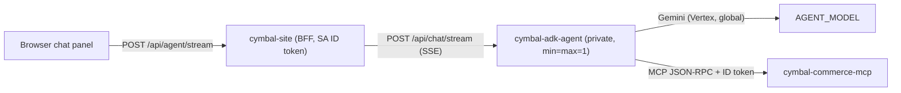

# shared/adk_agent — Cymbal Retail AI Concierge (ADK on Cloud Run)

Replaces the CES/GECX agent (`40_gecx_agent`, kept for reference) with a single ADK `LlmAgent` served by
FastAPI on Cloud Run, following the SSE protocol of `CONTRACT_JA_legacy.md` v3 and the English rules of
[CONTRACT_EN.md](../CONTRACT_EN.md) v14 (English replies, JPY `¥1,280`, Asia/Tokyo, persona CR-0001 Sakura Tanaka).



## Layout
| file | role |
|---|---|
| [server.py](server.py) | FastAPI + ADK `Runner` (`InMemorySessionService`), SSE `status/text/action/chips/done/error`, warmup |
| [cymbal_agent/agent.py](cymbal_agent/agent.py) | single `LlmAgent` `cymbal_concierge`; instruction ported from GECX Root/Shopping/Checkout + per-turn context (persona, date JST, cart/checkout, last shown ids) |
| [cymbal_agent/tools.py](cymbal_agent/tools.py) | MCP-backed tools + page-action tools (names = CONTRACT client functions) |
| [cymbal_agent/shop.py](cymbal_agent/shop.py) | pure cart / shipping / slots / order-id logic (mirrors `online-store/static/js/{cart,checkout}.js`) |
| [cymbal_agent/mcp_client.py](cymbal_agent/mcp_client.py) | MCP `tools/call` with cached ID token (metadata server; gcloud fallback locally) |
| [tests/test_shop.py](tests/test_shop.py) | unit tests (cart math, shipping, slots, order id, seeding, store_only) |
| [tests/test_tools.py](tests/test_tools.py) | tool tests with mocked MCP (find_store_stock, show_store_availability SSE, STORE_ONLY refusal) |
| [test_live.py](test_live.py) | live scenarios (a)–(h) with a page simulator + latency measurement |
| [deploy.sh](deploy.sh) | Cloud Run deploy + IAM, writes `DEPLOYMENT.env` (`ADK_AGENT_URL`) |

## Request / response
`POST /api/chat/stream` body: `{session_id, customer_id, customer_name, visitor_id, message, page_state:{cart, checkout, orders, page_context}}`
(optional non-contract `model` to override the model for benchmarking).

SSE (`data: <json>\n\n`), in order:
```json
{"type":"status","text":"Thinking…"}
{"type":"status","text":"Planning a dinner set for your family…"}
{"type":"action","name":"show_products_on_page","args":{"message":"Salted Mackerel Japanese Set (¥1,625, tax incl.)","theme":"…","product_ids":["4900231442791","…"],"reasons":["…"],"quantities":[2,1,1,1,1],"sections":[{"label":"Main","product_ids":["4900231442791"],"reasons":["…"],"tags":[["Frequently bought","Family favorite"]],"quantities":[2]}]},"result":{"shown":5}}
{"type":"text","text":"How about the \"Salted Mackerel Japanese Set\" tonight?","author":"cymbal_concierge"}
{"type":"chips","items":["Add the set to my cart","Another idea","Budget ¥1,500"]}
{"type":"done","session_id":"…","model":"gemini-3.5-flash","timings":{"first_status_ms":…,"first_action_ms":…,"first_text_ms":…,"total_ms":…}}
```
Other action examples:
```json
{"type":"action","name":"add_to_cart","args":{"product_id":"4900231442791","quantity":2},"result":{"ok":true,"cart_count":2,"cart_total_tax_included":642,"title":"Salted Mackerel Fillets (2 pcs)"}}
{"type":"action","name":"start_checkout","args":{},"result":{"ok":true,"slots":[{"slot_id":"d1_am","label":"Tomorrow 9:00-12:00"},…],"cart_total_tax_included":1625}}
{"type":"action","name":"select_delivery_slot","args":{"slot_id":"d1_pm"},"result":{"ok":true,"slot_label":"Tomorrow 14:00-17:00","payment_method":"Cymbal Pay (VISA **** 4242)","total_tax_included":1955,"subtotal_tax_included":1625,"shipping_fee":330,"next":"confirm"}}
{"type":"action","name":"place_order","args":{"order_id":"CR-20261105-6273"},"result":{"ok":true,"order_id":"CR-20261105-6273","total_tax_included":1955,"slot_label":"Tomorrow 14:00-17:00"}}
{"type":"action","name":"show_comparison","args":{"title":"…","product_ids":["a","b","c"],"rows":[{"label":"Price (tax incl.)","values":["¥1,848","¥3,608","¥4,606"]}]},"result":{"shown":true}}
{"type":"action","name":"get_order_status","args":{"order_id":"CR-…"},"result":{"order_id":"CR-…","status":"placed","status_label":"Order placed","eta":"Fri, Nov 6, 14:00-17:00 (Tomorrow 14:00-17:00)"}}
{"type":"action","name":"show_store_availability","args":{"product_ids":["SUSHI1"],"message":"Where to buy the sushi platter today"},"result":{"shown":1}}
```
Notes
- Actions are emitted only for successful / meaningful page changes; `add_to_cart` with unknown / out-of-stock /
  `store_only` ids is not emitted (the tool result is `{ok:false,error:"STORE_ONLY",message:…}` for in-store-only items).
  `start_checkout` with an empty cart IS emitted with `{ok:false,error:"EMPTY_CART"}`.
- `error` events: `{"type":"error","message":"Sorry, something went wrong. Please try again.","detail":"…"}`.
- `POST /api/chat` (non-stream) returns `{reply, actions, chips, tool_calls, session_id, model, timings, events}`.
- Status labels: `Thinking…`, `Searching products…`, `Checking store stock…`, … (see `STATUS_LABELS` in tools.py).

## Store availability (CONTRACT_EN v14)
- `find_store_stock(product_ids, store_id="")` → MCP `check_store_inventory` →
  `{items:[{product_id,title,channel,stores:[{store_id,name,address,open_now,hours,quantity,availability,pickup,shelf_label?}],online_available}]}`.
  On MCP failure it returns `{error, message, items:[{product_id,title,channel,stores:[],online_available}]}` (channel from the catalog).
- Page action `show_store_availability` `{product_ids:[str], message:str}` → result `{shown:n}`.
- `channel`: `omni` | `store_only` (cannot go in the delivery cart; `add_to_cart` refuses with `STORE_ONLY`) | `online_only`
  (not sold in stores). Channel is read from the baked catalog (`channel` key or attribute) or learned from MCP results
  (`search_products`, `get_product_details`, `check_store_inventory`).
- In-store pickup search: filter `pickupInStore: ANY("S01")` (S01 Kawasaki Station, S02 Musashi-Kosugi, S03 Shibuya).

## Latency design
- Single agent (no transfers), thinking budget 0 (`AGENT_THINKING_BUDGET`).
- Persona (`get_customer_profile`) fetched once per customer (10-min cache) and injected into the instruction.
- `recommend_dinner_set` auto-emits `show_products_on_page` (theme/sections/quantities) for the primary set, and
  `compare_products` auto-emits `show_comparison` — saves one LLM round-trip and avoids the model copying big JSON.
- Helper tools `show_dinner_set(i)` ("Another idea") and `add_dinner_set_to_cart()` (emits N `add_to_cart` actions with
  set quantities) — the emitted action names are still the CONTRACT client functions.
- Startup warmup: MCP `tools/list`, CR-0001 persona, model ping.

## Sessions
`InMemorySessionService` keyed by `session_id` → deploy with `--min-instances=1 --max-instances=1`
(a restart loses chat history, but cart/checkout/orders are re-seeded from `page_state` every turn).

## Configuration
| env | default |
|---|---|
| `MCP_URL` | `https://${MCP_SERVICE}-${PROJECT_NUMBER}.${REGION}.run.app` (a trailing `/mcp` is accepted) |
| `PROJECT_ID` / `GOOGLE_CLOUD_PROJECT` | from `config.env` |
| `PROJECT_NUMBER`, `REGION`, `MCP_SERVICE` | `config.env` values |
| `AGENT_MODEL`, `AGENT_THINKING_BUDGET` | `gemini-3.5-flash`, `0` |
| `ADK_AGENT_URL` (test_live.py) | `DEPLOYMENT.env` |

## Deploy / test
```bash
./deploy.sh                                   # AGENT_MODEL=gemini-3.5-flash by default
uv run --no-project --with pytest --with-requirements requirements.txt python -m pytest -q tests/
python3 test_live.py                          # live (a)–(h) against ADK_AGENT_URL with gcloud ID token
python3 test_live.py --url http://localhost:8080 --model gemini-3.8-flash
```
Local run:
```bash
source ../config.env
GOOGLE_GENAI_USE_VERTEXAI=TRUE GOOGLE_CLOUD_PROJECT=$PROJECT_ID GOOGLE_CLOUD_LOCATION=global python server.py
```
