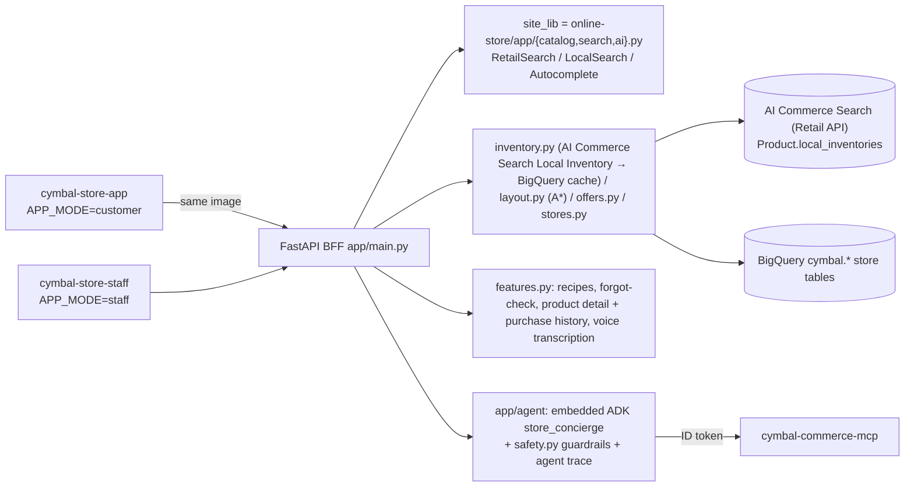

# Cymbal Retail Store App (`store-navi/`)

In-store shopping app for smartphones **and tablets** (customer, `cymbal-store-app`) + staff shelf registration
(`cymbal-store-staff`, owned by staffenrich) + an in-store AI Concierge (groceries, recipes, OTC medicine).
Contract: [`../CONTRACT_EN.md`](../CONTRACT_EN.md) (v14) · legacy APIs: [`../CONTRACT_JA_legacy.md`](../CONTRACT_JA_legacy.md) v8–v13 ·
OTC rules: [`docs/OTC_RULES_en.md`](docs/OTC_RULES_en.md).



## Layout

| Path | Content |
|---|---|
| `app/main.py` | routes, `APP_MODE=customer\|staff`, `/config.js` (`window.SN_CONFIG`), static mounts, features router |
| `app/config.py` | env only — no hard-coded project ids (`PROJECT_ID`, `PROJECT_NUMBER`, `ONLINE_STORE_URL`/`SITE_BASE_URL`, `RETAIL_LOCAL_INVENTORY`) |
| `app/inventory.py` | Availability `{product_id, channel, source, current, nearby, online}`; AI Commerce Search Local Inventory (parallel prefetch, 20 s cache) → BigQuery cache fallback; channel rules (`online_only` = no store stock, `store_only` = not online) |
| `app/features.py` | dish-first recipes (`data/recipes_en.json`), "Did you forget?", product detail with purchase history, Gemini voice transcription |
| `app/agent/` | `agent.py` (English instruction), `tools.py` (search / details / stock / show_store_items / suggest_recipes / suggest_replies + trace), `runner.py` (SSE v3 + `done.trace`), `safety.py` (English OTC guardrails), `mock.py` (scripted demo) |
| `static/customer/` | SPA (vanilla JS). Phone < 768 px single column; tablet portrait ≥ 768 px = list/detail/chat + floor map; landscape ≥ 1024 px = list · floor map · chat |
| `static/shared/` | tokens.css, sn-common.js (JPY en-US, badges, channel/source badges, Buy online link), logo |
| `data/` | stores S01–S03, layouts, inventory, shelf locations, coupons, offers, personas (owner: data) |

## Run locally

```bash
cd store-navi
python3 -m venv .venv && .venv/bin/pip install -r requirements.txt pytest playwright && .venv/bin/playwright install chromium
# customer app — offline (local search, store data files, scripted concierge)
DATA_MODE=local AGENT_MODE=mock ONLINE_STORE_URL=http://127.0.0.1:8080 .venv/bin/uvicorn app.main:app --port 8090
# live AI Commerce Search + BigQuery + Gemini agent from a workstation (ADC)
source ../config.env && DATA_MODE=bq AGENT_MODE=live .venv/bin/uvicorn app.main:app --port 8090
```

Env: `APP_MODE` customer|staff · `DATA_MODE` local|bq (Cloud Run default bq) · `AGENT_MODE` live|mock · `AGENT_MODEL` ·
`MCP_URL` (default `https://cymbal-commerce-mcp-${PROJECT_NUMBER}.${REGION}.run.app`) · `STAFF_URL` / `CUSTOMER_URL` /
`ENRICH_URL` (icon cross links) · `ONLINE_STORE_URL` (default `SITE_BASE_URL`) · `RETAIL_LOCAL_INVENTORY` (default 1) ·
`PHOTO_BUCKET` (default `${PROJECT_ID}-store-navi`) · `GEMINI_MODEL` / `GEMINI_LOCATION` (voice transcription).

## Tests

```bash
.venv/bin/python -m pytest tests -q --ignore=tests/e2e_customer.py --ignore=tests/e2e_staff.py
.venv/bin/python tests/e2e_customer.py --base-url http://127.0.0.1:8090
```

## Deploy

`SERVICE_NAME=cymbal-store-app ./deploy.sh` / `SERVICE_NAME=cymbal-store-staff ./deploy.sh` (owner: infra; sources `../config.env`).
